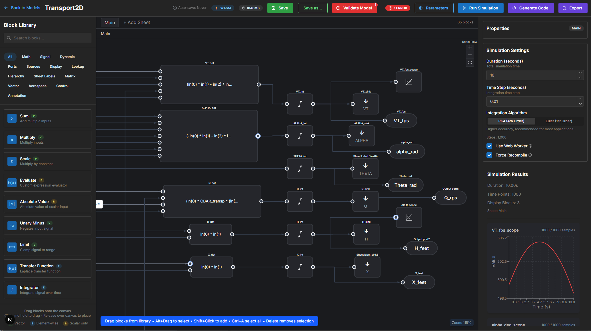

# obliq-2

A web-based visual modeling and simulation tool that enables users to construct, test, and simulate block diagram models directly in the browser, then generate C code for embedded deployment.

> **Important Note**: This project was almost entirely generated using Claude Opus and Sonnet 4 LLMs.  It is an exploration of how LLMs might help humans generate code - the code this application generates and the overall security of the application have not been formally verified. **In short, you'd be crazy to try to use this application for anything other than research.**

## Overview

obliq-2 is a browser-based application, designed for creating and simulating visual block diagram models. Users can drag and drop various block types onto a canvas, connect them with wires to define signal flow, run simulations to see how signals propagate through the system, and generate PlatformIO-compatible C code for deployment on embedded systems.



Release notes are in [CHANGELOG.md](CHANGELOG.md).


## Key Features

### Visual Modeling
- **Drag-and-drop interface** for building block diagrams
- **Multiple block types** including:
  - Mathematical operations (Sum, Multiply, Matrix Multiply, Scale, Trig functions, Vector functions, general math expressions)
  - Dynamic systems (Integrators and Laplace Transfer Functions)
  - Data operations (1D/2D Lookup Tables)
  - Visualization (Signal Display with plotting)
  - Signal generation (Source blocks for constants and generators, seeded Random Noise)
  - Hierarchical composition (Subsystem blocks)
  - Conditional Signal Flow Control
  - Discontinuities (Relay, Rate Limiter, Quantizer, Edge Detect)
  - Model-scoped Data Stores for cross-sheet signals
  - Aerospace utilities (orientation and units conversion, 1976 COESA atmosphere)
  - Signal type conversion

### Multiple Signal Types: Scalars, Vectors, and Matricies
- Support for C-style data types: `float`, `double`, `long`, `bool`
- 1D vector and 2D matrix support (e.g., `double[3]`, `float[3][3]`)
- Automatic type propagation through connections
- Type validation with visual error indicators

### Supported Block Types

| Block Type | Display Name | Category | Description |
|------------|--------------|----------|-------------|
| `source` | Source | Sources | Provides constant or signal generator output (step, ramp, sine, chirp, noise) |
| `clock` | Clock | Sources | Outputs current simulation time in seconds as a double scalar |
| `random_noise` | Random Noise | Sources | Seeded Gaussian or uniform white noise, held per sample period; σ or noise density (σ = N/√Ts); scalar or vector |
| `input_port` | Input Port | Ports | External input to a model or subsystem |
| `output_port` | Output Port | Ports | External output from a model or subsystem |
| `sum` | Sum | Math | Sums multiple input signals with configurable signs (+/-) |
| `multiply` | Multiply | Math | Element-wise multiplication of multiple input signals |
| `divide` | Divide | Math | Element-wise division (num/den); scalar denominator broadcasts over a vector/matrix numerator |
| `scale` | Scale | Math | Multiplies input by a scalar constant (gain) |
| `abs` | Absolute Value | Math | Absolute value of scalar input |
| `uminus` | Unary Minus | Math | Negates input (element-wise for vectors/matrices) |
| `square` | Square (x²) | Math | Element-wise square: y = u² (scalar, vector, or matrix) |
| `sign` | Sign | Math | Signum function: −1, 0, or +1 (element-wise for vectors/matrices) |
| `limit` | Limit | Math | Clamps signal values to specified upper/lower range |
| `evaluate` | Evaluate | Math | Evaluates custom C-style expression with multiple inputs |
| `trig` | Trig | Math | Trigonometric functions (sin, cos, tan, asin, acos, atan, atan2) |
| `transfer_function` | Transfer Function | Dynamic | Laplace transfer function with RK4 integration |
| `discrete_transform` | Discrete Transform | Dynamic | Discrete-time z-transform transfer function |
| `integrator` | Integrator | Dynamic | Integrator block (1/s) with optional limits and reset |
| `unit_delay` | Unit Delay | Dynamic | Unit delay (z⁻¹): outputs the previous sample; `sampleInterval` 0 means every step |
| `relay` | Relay | Discontinuities | Hysteresis switch: on when u ≥ onThreshold, off when u ≤ offThreshold |
| `rate_limiter` | Rate Limiter | Discontinuities | Limits the output's rate of change (units/sec) using the simulation time step |
| `quantizer` | Quantizer | Discontinuities | Rounds input to the nearest multiple of a quantum (element-wise) |
| `edge_detect` | Edge Detect | Discontinuities | Emits a one-step pulse on a rising, falling, or either edge |
| `lookup_1d` | 1-D Lookup | Lookup | 1-D lookup table with linear interpolation |
| `lookup_2d` | 2-D Lookup | Lookup | 2-D lookup table with bilinear interpolation |
| `matrix_multiply` | Matrix Multiply | Matrix | Matrix multiplication (A×B) or scalar multiplication |
| `transpose` | Transpose | Matrix | Matrix transpose; vectors [n] become [n][1] matrices |
| `mux` | Mux | Matrix | Multiplexer: combines scalars into vector or matrix |
| `demux` | Demux | Matrix | Demultiplexer: splits matrix/vector into scalar outputs |
| `selector` | Selector | Matrix | Selects vector elements by 0-based index (scalar output for a single index) |
| `cross` | Cross Product | Vector | 3D vector cross product (A × B) |
| `dot` | Dot Product | Vector | Vector dot product (A · B) |
| `mag` | Magnitude | Vector | Vector magnitude (Euclidean norm) |
| `if` | If | Control | Conditional selection based on control signal |
| `condition` | Condition | Control | Compares input against constant (>, <, >=, <=, ==, !=) |
| `data_store_write` | Data Store Write | Data | Writes a signal to a model-scoped named store, shared across sheets and subsystems |
| `data_store_read` | Data Store Read | Data | Reads a model-scoped named data store |
| `subsystem` | Subsystem | Hierarchical | Encapsulates another sheet as a reusable block |
| `signal_display` | Signal Display | Sinks | Real-time signal visualization during simulation |
| `signal_logger` | Signal Logger | Sinks | Logs signal values for CSV export |
| `assert` | Assert | Sinks | Test check: fails when its input leaves bounds, differs from an expected input, or is false; can stop the run |
| `no_connection` | No Connection | Sinks | Marks a signal as intentionally unused |
| `sheet_label_sink` | Sheet Label Sink | Sheet Labels | Receives signal for wireless routing within a sheet |
| `sheet_label_source` | Sheet Label Source | Sheet Labels | Outputs signal from corresponding sheet label sink |
| `orientation_conversion` | Orientation Conversion | Aerospace | Converts between Euler angles, DCM, and Quaternion (AIAA convention) |
| `units_conversion` | Units Conversion | Aerospace | Converts between SI and Imperial units |
| `body2quaternion_rates` | Body2Quat Rates | Aerospace | Converts body angular rates to quaternion rates |
| `atmosphere` | Atmosphere | Aerospace | U.S. Standard Atmosphere 1976 (COESA) from its layer formulae: T, a, P, ρ versus geometric altitude (m), −5 to 86 km |
| `comment` | Comment | Annotation | Text annotation with Markdown and LaTeX math support |

Two further block types are supported by simulation and code generation but are
**not offered in the block palette** — they exist so that models converted from
Simulink round-trip correctly:

| Block Type | Description |
|------------|-------------|
| `saturation_dynamic` | Element-wise `clamp(u, lo, up)`, with the limits supplied as signals rather than parameters |
| `inertia_diag_pack` | Packs principal-axis inertia and its derivative into `[Ixx, Iyy, Izz, İxx, İyy, İzz]` for aerolib mass properties |

### Diagram Layout
Right-click empty canvas and choose **Tune Model Layout...** to open a dialog of
independent adjustments, each of which can be left alone:

| Adjustment | Effect |
|------------|--------|
| **Clean up block layout** | Arranges blocks so data flows left to right and routes the turns of the wires between them |
| **Resize Subsystems** | Sizes subsystem blocks so their ports fit what they connect to |
| **Subsystem Ports Labeling** | Shows or hides port-name labels on subsystem blocks |
| **Hide unnecessary block names** | Hides names on everything except subsystems |
| **Scope** | Current sheet (default), current subsystem, or the entire model |

**Block placement**
- Blocks are ranked into columns by signal flow, so data runs left to right. Feedback loops are detected and do not disturb the ordering.
- Only a sheet's **boundary** blocks are pinned to the edges: Input Ports on the left, and Output Ports, displays and loggers on the right.
- **Gotos** and data-store writes sit just after the block that drives them. **Froms**, data-store reads, constants and clocks sit just before the block they feed. Their wires stay short instead of fanning across the whole sheet.
- Layout is **port-aware**. Each block is pulled toward the ports it connects to, over wires of *any* length, not just to the neighboring column. The column is then ordered by those targets, so a block lands vertically close to the output that feeds it, and wires run straight wherever the geometry allows.

**Wire routing**
- The editor draws each wire as across, down, across. Cleaning up the layout also decides where each wire turns, instead of always turning midway between its ports.
- Each turn is placed in the gap between block columns where it causes the fewest crossings, overlaps with other wires, and runs through blocks.
- Within a gap, every net (all wires from one output port) gets its own vertical track, ordered to avoid crossings. Wires from one output share a track, which reads as a junction.
- Gaps that need many tracks are widened so tracks stay 8 px apart.
- Turn positions are saved with each wire. Straight wires, feedback wires and enable/reset connections keep the default midpoint, which also clears turns dragged by hand before the blocks moved.
- To adjust a wire yourself, hover its vertical segment and drag it left or right from anywhere along its length.

**Other notes**
- Resizing grows a subsystem until its ports are far enough apart for neighboring blocks to line up with them, and writes the result into the model as `width` / `height`.
- A scope may reach sheets nested inside subsystems that are not currently open, so the dialog reports how many sheets a scope covers and warns when that is more than one. Tuning cannot be undone, but every Save keeps a version snapshot.
- Subsystem blocks can also be resized by hand: right-click the block, choose **Resize...**, and drag any corner handle.

### Block Name Visibility
- A newly added block **hides its name**; a Subsystem is the exception and shows it, since the name is what distinguishes one subsystem from another
- Toggle an individual block with **Hide Name** / **Show Name** on its right-click menu, or a whole scope at once from **Tune Model Layout...**
- Blocks saved before this setting existed carry no value and keep showing their names, so existing models look exactly as they did

### Printing and PDF Export
- **Export → Export as PDF…** in the toolbar renders the model as a printable document, one page per sheet
- Output is **true vector** — drawn from model data rather than captured from the screen — so large-format plots stay sharp and files stay small
- Options: file name, orientation, page size, scaling (100%, 50%, or scale to fit), large-sheet fitting, and print scope
- Page sizes cover US (Letter, Legal, Tabloid), ISO (A0–A5), and blueprint sizes (ANSI C–E, ARCH A–E, ARCH E1)
- Print scope selects the entire model, the current subsystem, or just the current sheet
- Optional **subsystem summary pages** list a subsystem's input and output ports, its parameters with types and values, and its sheet hierarchy
- Every page carries a footer: the owning subsystem's full path in bold on its own wrapping line, then the model name, sheet name, page number, and print date
- Text is **never shortened by default**, so everything in the document stays findable by search. An **Allow Text Truncation** group re-enables ellipses separately for block names and for in-block information (port labels, expressions)

### Simulation Engine
- **Client-side simulation** - Models are compiled dynamically and executed as [Web Assemblies](https://webassembly.org/)
- Real-time signal visualization with Recharts
- Configurable time steps, duration, and integration methods, saved with the model
- Signal logging with CSV export capability
- Support for both continuous and discrete-time systems

### Testing Models
- **Assert blocks** check a signal at every step: within bounds, near an expected signal, or true. After a run the toolbar shows how many passed, with a Test Results panel and pass/fail marks on the blocks.
- **`npm run obliq:test`** runs models' Asserts from the command line, natively, with each model's saved simulation settings:

  ```bash
  npm run obliq:test -- "My Model"           # by name, id, or a model JSON file
  npm run obliq:test -- --all --junit out.xml  # every stored model with Asserts, JUnit for CI
  ```

  It exits 0 when every Assert passed, 1 when one failed (or a named model has none), and 2 when a model could not be found, built or run. It needs a C compiler (`$CC`, else `cc`). Add `--json` for machine-readable results.
- Exported C keeps Assert checks behind `OBLIQ_ASSERTS`, off by default.

### Code Generation
- **PlatformIO-compatible C code** generation
- Preserves signal and block names for readable code
- Generates structured APIs with input/output/state structs
- Support for Runge-Kutta 4th order or Euler integration in generated code

### Local, File-Based Storage
- Runs locally as your OS user; no database server or account needed
- Models stored as JSON files under `~/.config/obliq-2/` with a SQLite index
- Version snapshots on save, auto-save every 5 minutes
- Link models to files elsewhere on disk (e.g. generated by scripts); changes made on disk are detected while a model is open
- Model management dashboard

### Automation and Model Building APIs + MCP Server
- RESTful API for CI/CD integration and model building
- Supports construction, automated validation, simulation, and code generation
- Token-based authentication for external systems
- API token management (/tokens page)
- Includes an MCP server capable of interacting with these APIs

### Reference Models
- [`reference-models/`](reference-models/) holds example models that are imported once into a new installation's store; existing installations can add them with **My Models → Import Model**
- **FPV Quadcopter**: a 5-inch quad at Tri-County Aerodrome (48TX), Texas, with motors, battery, ground contact, IMU/magnetometer/barometer models and a Betaflight-style flight controller (acro and angle modes, Mahony estimator). It is built by `scripts/build-fpv-reference-model.ts`; design and sources are in [docs/fpv-reference-model-plan.md](docs/fpv-reference-model-plan.md)

## Tech Stack

- **Frontend**: Mantine, Next.js (App Router), React, ReactFlow, TypeScript
- **Backend**: Next.js API routes running on a local Node.js server (bound to `127.0.0.1`)
- **Storage**: SQLite (`better-sqlite3`) index + flat JSON model files under `~/.config/obliq-2/`
- **Authentication**: Local session cookie (browser) and hashed API tokens (MCP/automation)
- **State Management**: Zustand
- **Visualization**: Recharts for signal charting
- **Code Generation**: Server-side TypeScript to C transpilation
- **Model Compilation**: Custom Docker image with gcc and WASM tooling

## Installation and Development Setup

obliq-2 is a single-user local application. It needs:

1. **This Next.js app** — `npm run dev` serves it on `http://127.0.0.1:3000`
2. **Docker** — used to compile models to WebAssembly when you click **Run Simulation**

There is no database server and no account. Everything is stored per OS user under `~/.config/obliq-2/` (see [Local storage](#local-storage)).

### Prerequisites

| Requirement | Notes |
|-------------|--------|
| **Node.js 20+** and npm | App and tests (`better-sqlite3` is a native module; prebuilt binaries cover common platforms) |
| **Docker** | WASM compile image (`obliq-emscripten`) |

### 1. Clone and install

```bash
git clone https://github.com/rrainey/obliq-2.git
cd obliq-2
npm install
node verify-setup.js     # checks Docker, the storage directory, and SQLite
```

`.env.local` is optional. See [`.env.local.example`](./.env.local.example) for the few settings that exist (`OBLIQ_HOME`, `OBLIQ_ALLOWED_HOSTS`, MCP/test tokens).

### 2. (Optional) WASM compile image for simulation

Needed before **Run Simulation** compiles models:

```bash
npm run wasm:build-docker
# Builds Docker image: obliq-emscripten:latest
```

See also [`WASM-SETUP-INSTRUCTIONS.md`](./WASM-SETUP-INSTRUCTIONS.md).

### 3. Start the web application

```bash
npm run dev
```

Open [http://localhost:3000](http://localhost:3000) and you land on **My Models**.

The server binds to `127.0.0.1` and refuses requests whose `Host` is not a loopback name. The browser is authenticated with an httpOnly cookie signed by `~/.config/obliq-2/local-secret`. MCP, automations and scripts use API tokens created on the **/tokens** page.

### Local storage

```text
~/.config/obliq-2/                 # $OBLIQ_HOME overrides; honors $XDG_CONFIG_HOME
  obliq.db                         # SQLite: model index, version list, API token hashes, WASM cache metadata
  local-secret                     # signs the browser session cookie (0600)
  models/<id>/
    model.json                     # current model ({ "name", "data" }), managed models only
    versions/v0001.json ...        # snapshots written on each explicit Save
    autosave.json
  cache/wasm/<cacheKey>/           # compiled module.wasm + module.js
```

- **model.json is the current state.** **Save** writes it and records a new snapshot under `versions/`. Model Builder API/MCP mutations update it in place; pass `checkpoint: true` to also record a snapshot.
- **External edits are safe.** Scripts may edit or regenerate a model file directly. The editor watches the open model's file:
  - With no unsaved edits, it reloads automatically.
  - With unsaved edits, it shows a banner: **Reload from disk**, **Keep mine (overwrite)**, or **Save mine as new model**.
  - If the file disappears, it says so and offers Save As.

  The disk content is always recorded as a version with note `external` before anything overwrites it. A save based on a stale copy is rejected (HTTP 409) rather than silently overwriting.
- **Linked models.** **My Models → Link File** (or `npm run obliq:link -- /abs/path/model.json [--name "Name"]`, which works without the server running) registers a file that lives elsewhere, such as a generated plant model in another repo. `npm run obliq:link -- --list` lists models and their file locations. The file stays where it is and saves write back to it in the same shape (`{name, data}` or bare ModelData). Its versions and autosave live under `models/<id>/`. Deleting a linked model never deletes the external file. **Copy into Obliq storage** (model menu, or `obliq:link -- --unlink <id>`) detaches it. A linked file that has gone missing is flagged on My Models.

### Migrating from the previous Supabase backend

```bash
# .env.local must still contain NEXT_PUBLIC_SUPABASE_URL and SUPABASE_SERVICE_ROLE_KEY
npm run migrate:supabase -- --dry-run          # preview
npm run migrate:supabase                       # import all versions, autosaves, API token hashes
npm run migrate:supabase -- --user you@example.com   # if the instance has several users
```

The import is idempotent: models already present locally are skipped. API token hashes carry over, so existing MCP tokens keep working. The WASM cache is not migrated and rebuilds on demand. The old SQL schema is archived in [`docs/archive/supabase-database-scripts/`](./docs/archive/supabase-database-scripts/).

### Loading sample models (Import)

From **My Models** (`/models`), use **Import** to create a new model from JSON. This matches the **Export** format and the fixtures under [`docs/sample-models/`](./docs/sample-models/):

```json
{
  "name": "Subs01",
  "data": { "version": "2.2", "sheets": [ ... ], "parameters": [ ... ], "globalSettings": { ... } }
}
```

1. **My Models** → **Import**.
2. Choose a file such as `docs/sample-models/Subs01.json`.
3. Confirm or edit the model name → **Import** (opens the editor).
4. Optionally add **Signal Display** / **Signal Logger** sinks (many fixtures only expose output ports).
5. **Run Simulation** (Docker + `npm run wasm:build-docker` required for compile).

Import always creates a **new** model (version 1). Bare `{ "sheets": [...] }` data objects are also accepted (name defaults from the file name).

### Common setup mistakes

| Symptom | Likely cause |
|---------|----------------|
| "Could not start local session" | Opening the app through a non-loopback hostname; use `localhost` or set `OBLIQ_ALLOWED_HOSTS` |
| `better-sqlite3` load error | Native module built for another Node version: `npm rebuild better-sqlite3` |
| Save fails with "changed on disk" | The model file was edited outside the app after you opened it; reload, or Save As |
| Run Simulation compile fails | Docker not running or `npm run wasm:build-docker` never run |

### Development Commands

```bash
# Run tests
npm test

# Run tests in watch mode
npm run test:watch

# Run tests with coverage
npm run test:coverage

# Build for production
npm run build

# Start production server
npm start

# Run linter
npm run lint

# WASM Docker image + tests
npm run wasm:build-docker
npm run test:wasm

# Quick Docker / storage / SQLite check
node verify-setup.js

# Run models' Assert blocks (see Testing Models)
npm run obliq:test -- --all
```

## Project Structure

```
obliq-2/
├── src/
│   ├── app/                          # Next.js App Router pages
│   │   ├── api/
│   │   │   ├── automations/          # Automation API (CI/CD, external triggers)
│   │   │   ├── compile-wasm/         # WASM compilation endpoint
│   │   │   ├── compile-wasm-stream/  # SSE-based WASM compilation
│   │   │   ├── generate-code/        # C code generation endpoint
│   │   │   ├── model-builder/        # Model Builder API (programmatic model construction)
│   │   │   ├── models/               # REST API used by the UI (list, load, save, versions, autosave, link)
│   │   │   ├── session/              # Establishes the local browser session cookie
│   │   │   └── tokens/               # API token management
│   │   ├── admin/                    # Admin pages (API metrics)
│   │   ├── models/                   # Model editor and dashboard
│   │   └── tokens/                   # Token management UI
│   │
│   ├── components/                   # React components
│   │   ├── BlockNode.tsx             # Main block rendering component
│   │   ├── CanvasReactFlow.tsx       # ReactFlow canvas wrapper
│   │   ├── BlockLibrarySidebar.tsx   # Drag-and-drop block palette
│   │   ├── SignalDisplay.tsx         # Real-time signal visualization
│   │   ├── SimulationDisplayPanel.tsx
│   │   ├── *Config.tsx               # Block configuration dialogs
│   │   └── ...
│   │
│   ├── lib/
│   │   ├── blocks/                   # Block module implementations
│   │   │   ├── BlockModule.ts        # Base block interface
│   │   │   ├── BlockModuleFactory.ts # Factory for creating block modules
│   │   │   └── *BlockModule.ts       # Individual block implementations
│   │   │
│   │   ├── codegen/                  # C code generation pipeline
│   │   │   ├── CodeGenerator.ts      # Main code generator orchestrator
│   │   │   ├── ModelFlattener.ts     # Flattens hierarchical models
│   │   │   ├── AlgebraicEvaluator.ts # Topological sort and evaluation order
│   │   │   ├── StateIntegrator.ts    # RK4 integration code generation
│   │   │   ├── HeaderGenerator.ts    # Header file generation
│   │   │   ├── SubsystemCodeGenerator.ts  # Segregated subsystem support
│   │   │   └── ...
│   │   │
│   │   ├── server/                   # Server-only code (never import from client components)
│   │   │   ├── storage/              # SQLite index + flat-file model store (ModelRepository, TokenRepository)
│   │   │   ├── modelWatcher.ts       # Watches open models' files for changes on disk (feeds the SSE stream)
│   │   │   └── session.ts            # Local session cookie
│   │   │
│   │   ├── layout/                   # Auto-layout and shared block geometry
│   │   │   ├── autoLayout.ts         # Layered left-to-right arrangement
│   │   │   ├── wireRouting.ts        # Wire turn placement (per-net tracks between columns)
│   │   │   ├── tuneModelLayout.ts    # Scoped layout / resize / name tuning
│   │   │   └── blockGeometry.ts      # Block sizes / port offsets (shared with the canvas)
│   │   │
│   │   ├── export/                   # PDF export
│   │   │   ├── pdfRenderer.ts        # Vector renderer (pdf-lib)
│   │   │   ├── pageSizes.ts          # US / ISO / blueprint page table
│   │   │   ├── sheetTree.ts          # Sheet enumeration, paths, print scope
│   │   │   └── blockGlyphs.ts        # Symbol classification + glyph work list
│   │   │
│   │   ├── simulation/               # Browser-side simulation engine
│   │   │   ├── WasmSimulationEngine.ts    # WASM-based simulation
│   │   │   ├── SimulationWorker.ts        # Web Worker for off-main-thread
│   │   │   ├── SimulationWorkerManager.ts # Worker lifecycle management
│   │   │   └── SimulationEngineFactory.ts # Factory for engine creation
│   │   │
│   │   ├── wasm/                     # WebAssembly infrastructure
│   │   │   ├── ServerWasmExecutor.ts # Server-side WASM execution
│   │   │   ├── WasmErrorParser.ts    # Emscripten error parsing
│   │   │   ├── cache/                # WASM module caching (files under ~/.config/obliq-2/cache)
│   │   │   └── codegen/              # WASM-specific code generation
│   │   │
│   │   ├── blockTypeRegistry.ts      # Block type definitions and metadata
│   │   ├── blockFactory.ts           # Unified block creation
│   │   ├── blockParameterValidator.ts # Parameter validation/sanitization
│   │   ├── modelStore.ts             # Zustand state management
│   │   ├── signalTypePropagation.ts  # Type inference through connections
│   │   ├── connectionValidation.ts   # Wire validation logic
│   │   ├── c99Expression*.ts         # C99 expression parser/evaluator
│   │   └── ...
│   │
│   ├── hooks/                        # React hooks
│   └── types/                        # TypeScript type definitions
│
├── mcp-server/                       # MCP Server (Model Context Protocol)
│   └── src/
│       ├── index.ts                  # Server entry point (STDIO + HTTP modes)
│       ├── tools/
│       │   ├── model-management.ts   # create_model, get_model, list_models
│       │   ├── model-construction.ts # add_block, add_connection, etc.
│       │   ├── block-types.ts        # list_block_types (parameter discovery)
│       │   ├── simulation.ts         # run_simulation
│       │   ├── code-generation.ts    # generate_code
│       │   ├── validation.ts         # validate_model
│       │   └── batch-operations.ts   # batch_execute
│       ├── modelBuilderClient.ts     # Model Builder API client
│       └── client.ts                 # Automation API client
│
├── __tests__/                        # Test suites
│   ├── *-block.test.ts               # Block module unit tests (one file per block)
│   ├── codegen/                      # Code generation tests
│   ├── simulation/                   # Simulation engine tests
│   ├── wasm/                         # WASM compilation and execution tests
│   ├── integration/                  # Integration tests (Docker/PlatformIO)
│   └── utils/                        # Test utilities (TestModelBuilder, etc.)
│
├── design/                           # Architecture documentation
│   └── 00-architecture.md            # Comprehensive system architecture
│
├── docs/                             # API documentation
│   ├── automation-api.md
│   ├── model-builder-api.md
│   └── wasm-*.md                     # WASM documentation
│
├── examples/                         # Example scripts
│   └── model-builder-api/            # API usage examples
│
└── scripts/                          # Command-line tools
    ├── obliq-link.ts                 # npm run obliq:link — link/list/unlink model files
    ├── migrate-from-supabase.ts      # npm run migrate:supabase — one-time import from 2.x
    ├── obliq-cgen.ts                 # npm run obliq:cgen — C code from a model JSON file
    └── obliq-test.ts                 # npm run obliq:test — run models' Assert blocks
```

## Testing

The project includes comprehensive test suites for both the simulation engine and C code generation.

### Unit Tests

Run the standard test suite:
```bash
# Run all tests
npm test

# Run tests in watch mode
npm run test:watch

# Run tests with coverage
npm run test:coverage
```

### C Code Generation Tests

The C code generation tests use Docker to ensure consistent compilation environments. These tests:
- Generate C code from test models
- Compile the generated code using PlatformIO in a Docker container
- Execute the compiled binaries to verify correctness

#### Prerequisites

1. **Docker**: Ensure Docker is installed and running on your system
   - [Docker Desktop](https://www.docker.com/products/docker-desktop/) for Windows/Mac
   - [Docker Engine](https://docs.docker.com/engine/install/) for Linux

Obliq-2 leverages Docker to compile and link a simulation model for execution.  The compiled WebAssembly modules are cached under `~/.config/obliq-2/cache/wasm/`.

2. **Initial Setup**: The test suite will automatically build the required Docker image on first run

#### Running Code Generation Tests

```bash
# Run C code generation and compilation tests
npm run test:codegen

# Run with verbose output
npm run test:codegen -- --verbose
```

### WebAssembly (WASM) Tests

**NEW:** The project now supports compiling models to WebAssembly for high-performance browser simulation.

WASM tests verify that:
- C code can be compiled to WebAssembly using Emscripten
- WASM modules load and execute correctly in both Node.js and browsers
- Generated models produce identical results when run as WASM

#### Running WASM Tests

```bash
# Build Emscripten Docker image (first time only)
npm run wasm:build-docker

# Run all WASM tests
npm run test:wasm

# Run specific WASM test suites
npm run test:wasm:setup   # Basic Emscripten setup
npm run test:wasm:model   # Full model compilation
```

#### Quick Start Guide

See [`__tests__/wasm/QUICKSTART.md`](__tests__/wasm/QUICKSTART.md) for a step-by-step verification guide.

**Documentation:**
- **Quick Start**: [`__tests__/wasm/QUICKSTART.md`](__tests__/wasm/QUICKSTART.md)
- **Full Documentation**: [`__tests__/wasm/README.md`](__tests__/wasm/README.md)
- **Architecture**: [`docs/wasm-simulation-architecture_1.md`](docs/wasm-simulation-architecture_1.md)
- **Implementation Roadmap**: [`docs/wasm-implementation-roadmap.md`](docs/wasm-implementation-roadmap.md)

The tests will:
1. Build a Docker image with PlatformIO if not already present
2. Generate C code for various test models
3. Create proper PlatformIO library structures
4. Compile the generated code in isolated Docker containers
5. Execute the compiled programs and verify outputs

#### Test Models

Test models are stored in `__tests__/integration/code-generation/models/` as JSON files. Each model can include:
- `metadata.testInputs`: Input values for testing
- `metadata.expectedOutput`: Expected output for validation
- `metadata.description`: Test case description

#### Troubleshooting

If tests fail:
1. Check Docker is running: `docker --version`
2. Verify the Docker image exists: `docker images | grep platformio-test`
3. Check test output for compilation errors


## Usage

1. **Create a Model**: Click "New Model" from the dashboard
2. **Build Your Diagram**: Drag blocks from the library and connect them with wires
3. **Configure Blocks**: Click blocks to set parameters (e.g., transfer function coefficients)
4. **Run Simulation**: Click "Run Simulation" to see signals propagate in real-time
5. **Tidy the Layout**: Right-click empty canvas and choose **Tune Model Layout...**
6. **Generate Code**: Choose **Export → Generate Code (C library)** to download a PlatformIO-compatible library
7. **Export Data**: Use Signal Logger blocks to capture and export simulation data
8. **Print or Share**: Choose **Export → Export as PDF…** for a printable document, one page per sheet

## License

This project is covered by the MIT License.

## Acknowledgments

This project was almost entirely generated using Claude Opus, demonstrating the capabilities of large language models in software development.