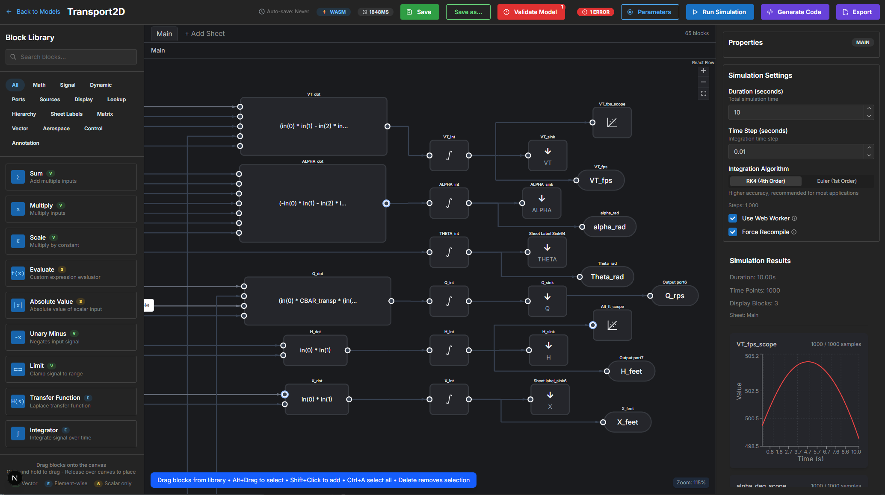

# obliq-2

Construct, test, and simulate block diagram models directly in your browser, then generate C code for embedded deployment.

> **Important Note**: This project was almost entirely generated using Claude Opus and Sonnet 4 LLMs.  It is an exploration of how LLMs might help humans generate code - the code this application generates and the overall security of the application have not been formally verified. **In short, while a lot of serious work has gone into this project its readiness for high stakes applications remains to be proved. Use it at your own risk.**

## Overview

obliq-2 is a browser-based application, designed for creating and simulating visual block diagram models. Drag and drop various block types onto a canvas, connect them with wires to define signal flow, run simulations to see how signals propagate through the system, and generate PlatformIO-compatible C code for deployment on embedded systems.



Release notes are in [CHANGELOG.md](CHANGELOG.md).

## Key Features

### Visual Modeling
- **Drag-and-drop interface** for building block diagrams
- **Multiple block types** including:
  - Mathematical operations (Sum, Multiply, Matrix Multiply, Scale, Trig functions, Vector functions, general math expressions)
  - Dynamic systems (Integrators and Laplace Transfer Functions)
  - Data operations (1D/2D Lookup Tables)
  - Visualization (Signal Display with plotting)
  - Signal generation (Source blocks for constants and generators, seeded Random Noise)
  - Hierarchical composition (Subsystem blocks)
  - Conditional Signal Flow Control
  - Discontinuities (Relay, Rate Limiter, Quantizer, Edge Detect)
  - Model-scoped Data Stores for cross-sheet signals
  - Aerospace utilities (orientation and units conversion, 1976 COESA atmosphere)
  - Signal type conversion

### Multiple Signal Types: Scalars, Vectors, and Matricies
- Support for C-style data types: `float`, `double`, `long`, `bool`
- 1D vector and 2D matrix support (e.g., `double[3]`, `float[3][3]`)
- Automatic type propagation through connections
- Type validation with visual error indicators

### Supported Block Types

| Block Type | Display Name | Category | Description |
|------------|--------------|----------|-------------|
| `source` | Source | Sources | Provides constant or signal generator output (step, ramp, sine, chirp, noise) |
| `clock` | Clock | Sources | Outputs current simulation time in seconds as a double scalar |
| `random_noise` | Random Noise | Sources | Seeded Gaussian or uniform white noise, held per sample period; σ or noise density (σ = N/√Ts); scalar or vector |
| `input_port` | Input Port | Ports | External input to a model or subsystem |
| `output_port` | Output Port | Ports | External output from a model or subsystem |
| `sum` | Sum | Math | Sums multiple input signals with configurable signs (+/-) |
| `multiply` | Multiply | Math | Element-wise multiplication of multiple input signals |
| `divide` | Divide | Math | Element-wise division (num/den); scalar denominator broadcasts over a vector/matrix numerator |
| `scale` | Scale | Math | Multiplies input by a scalar constant (gain) |
| `abs` | Absolute Value | Math | Absolute value of scalar input |
| `uminus` | Unary Minus | Math | Negates input (element-wise for vectors/matrices) |
| `square` | Square (x²) | Math | Element-wise square: y = u² (scalar, vector, or matrix) |
| `sign` | Sign | Math | Signum function: −1, 0, or +1 (element-wise for vectors/matrices) |
| `limit` | Limit | Math | Clamps signal values to specified upper/lower range |
| `evaluate` | Evaluate | Math | Evaluates custom C-style expression with multiple inputs |
| `trig` | Trig | Math | Trigonometric functions (sin, cos, tan, asin, acos, atan, atan2) |
| `transfer_function` | Transfer Function | Dynamic | Laplace transfer function with RK4 integration |
| `discrete_transform` | Discrete Transform | Dynamic | Discrete-time z-transform transfer function |
| `integrator` | Integrator | Dynamic | Integrator block (1/s) with optional limits and reset |
| `unit_delay` | Unit Delay | Dynamic | Unit delay (z⁻¹): outputs the previous sample; `sampleInterval` 0 means every step |
| `relay` | Relay | Discontinuities | Hysteresis switch: on when u ≥ onThreshold, off when u ≤ offThreshold |
| `rate_limiter` | Rate Limiter | Discontinuities | Limits the output's rate of change (units/sec) using the simulation time step |
| `quantizer` | Quantizer | Discontinuities | Rounds input to the nearest multiple of a quantum (element-wise) |
| `edge_detect` | Edge Detect | Discontinuities | Emits a one-step pulse on a rising, falling, or either edge |
| `lookup_1d` | 1-D Lookup | Lookup | 1-D lookup table with linear interpolation |
| `lookup_2d` | 2-D Lookup | Lookup | 2-D lookup table with bilinear interpolation |
| `matrix_multiply` | Matrix Multiply | Matrix | Matrix multiplication (A×B) or scalar multiplication |
| `transpose` | Transpose | Matrix | Matrix transpose; vectors [n] become [n][1] matrices |
| `mux` | Mux | Matrix | Multiplexer: combines scalars into vector or matrix |
| `demux` | Demux | Matrix | Demultiplexer: splits matrix/vector into scalar outputs |
| `selector` | Selector | Matrix | Selects vector elements by 0-based index (scalar output for a single index) |
| `cross` | Cross Product | Vector | 3D vector cross product (A × B) |
| `dot` | Dot Product | Vector | Vector dot product (A · B) |
| `mag` | Magnitude | Vector | Vector magnitude (Euclidean norm) |
| `if` | If | Control | Conditional selection based on control signal |
| `condition` | Condition | Control | Compares input against constant (>, <, >=, <=, ==, !=) |
| `data_store_write` | Data Store Write | Data | Writes a signal to a model-scoped named store, shared across sheets and subsystems |
| `data_store_read` | Data Store Read | Data | Reads a model-scoped named data store |
| `subsystem` | Subsystem | Hierarchical | Encapsulates another sheet as a reusable block |
| `signal_display` | Signal Display | Sinks | Real-time signal visualization during simulation |
| `signal_logger` | Signal Logger | Sinks | Logs signal values for CSV export |
| `assert` | Assert | Sinks | Test check: fails when its input leaves bounds, differs from an expected input, or is false; can stop the run |
| `no_connection` | No Connection | Sinks | Marks a signal as intentionally unused |
| `sheet_label_sink` | Sheet Label Sink | Sheet Labels | Receives signal for wireless routing within a sheet |
| `sheet_label_source` | Sheet Label Source | Sheet Labels | Outputs signal from corresponding sheet label sink |
| `orientation_conversion` | Orientation Conversion | Aerospace | Converts between Euler angles, DCM, and Quaternion (AIAA convention) |
| `units_conversion` | Units Conversion | Aerospace | Converts between SI and Imperial units |
| `body2quaternion_rates` | Body2Quat Rates | Aerospace | Converts body angular rates to quaternion rates |
| `atmosphere` | Atmosphere | Aerospace | U.S. Standard Atmosphere 1976 (COESA) from its layer formulae: T, a, P, ρ versus geometric altitude (m), −5 to 86 km |
| `comment` | Comment | Annotation | Text annotation with Markdown and LaTeX math support |
| `saturation_dynamic` | Element-wise `clamp(u, lo, up)`, with the limits supplied as signals rather than parameters |
| `inertia_diag_pack` | Packs principal-axis inertia and its derivative into `[Ixx, Iyy, Izz, İxx, İyy, İzz]` for aerolib mass properties |

### Diagram Layout

To lay out a model, right-click the empty canvas and choose **Tune Model Layout...**. The dialog has independent adjustments. You can leave each one as it is.

| Adjustment | Default | Effect |
|------------|---------|--------|
| **Clean up block layout** | Yes | Puts the blocks in signal-flow order from left to right, and routes each wire around the blocks |
| **Layout engine** | ELK Layered | **ELK Layered** (`elkjs`) or **Classic**, the engine of earlier releases. The adjustments below that say "ELK only" have no effect with Classic |
| **Use subsystem functions for signal flow order** | On | ELK only. Puts each control loop in the order controller, actuator, plant, with sensors and compensators on the return path. See **Subsystem Function** |
| **Mirror feedback-path blocks** | On | ELK only, with subsystem functions. Puts the return path of a loop on a flipped row below the forward path. See **Return row** |
| **Tidy signal labels (changes the model)** | Off | ELK only. Replaces long wires that cross many other wires with Sheet Label pairs. See **Tidy signal labels** |
| **Resize Subsystems** | No | Sizes subsystem blocks so that their ports align with the blocks they connect to. Adjacent ports are at most **Maximum port spacing** apart (default 40 px; the natural spacing is 20 px) |
| **Subsystem Ports Labeling** | Leave as-is | Shows or hides the port names on subsystem blocks |
| **Hide unnecessary block names** | No | Hides the names of all blocks except subsystems |
| **Scope** | Current sheet | The current sheet, the current subsystem, or the entire model |

A scope can include sheets in subsystems that are not open. The dialog shows how many sheets a scope covers, and it warns when that is more than one. You cannot undo a layout, but each Save keeps a version snapshot.

**Block placement (ELK Layered)**
- Blocks go into layers by signal flow, so data goes from left to right. Input Ports go in the first layer and Output Ports in the last layer, with the exception that follows.
- **Output Ports beside their hosts.** The layout also lays out each sheet that has an Output Port with each Output Port beside the block output that drives it, as a satellite (see below). On a flipped host, the Output Port is on the left of the host. The layout keeps this result only when it has fewer crossings and no wire through a block, overlap, wire end against its port direction or small step. Else the Output Ports stay in the last layer. This follows MAB guideline db_0042: Outports go on the right, but you can move them to prevent wire crossings. The command line can force one result (`--output-ports column` or `beside`).
- In a feedback loop, the feedback wires are the wires that go back to an earlier block in the signal-flow order.
- **Satellite blocks** are leaf blocks with one wire: Sheet Label Sinks and Sources, constants, clocks, data store reads and writes, No Connection blocks, displays and loggers (and Output Ports, see above). The layout puts a satellite beside the block that it connects to (its host), on the row of the host port, so that its wire is straight:
  - a Sheet Label Sink, a data store write, a display, a logger or an Output Port goes to the right of the host's output port;
  - a Sheet Label Source, a constant or a data store read goes to the left of the host's input port.
- When adjacent satellites do not fit in one column, the layout **staggers** them across two or more sub-columns. The wire to a farther satellite goes past the nearer satellites and their names.
- When the ports of a host are too near each other for its satellites, each satellite wire turns one time. These wires do not cross. To make more of these wires straight, also select **Resize Subsystems**.
- When a host port also feeds other blocks, its satellite stays beside the port. The wire to the other blocks leaves the satellite's wire at a junction in front of the satellite.
- On a sheet with satellites that are not Sheet Labels (for example constants), the layout also lays out the sheet with only the Sheet Labels as satellites. It keeps the result with fewer crossings. If the crossings are equal, it keeps the result with fewer bends, then the shorter total wire length, then the smaller sheet area. If all of these are equal, it keeps the result with all satellites.
- A **pass-through sheet** (a sheet with only small independent parts, for example Sheet Label Source and Output Port pairs) becomes a grid. The parts are in model order, from top to bottom and then in the next column.
- **Minimum subsystem height.** A subsystem whose ports are nearer than 20 px to each other grows to its natural height. The layout does not make a block smaller. The dialog counts these blocks as resized.
- **Port names.** When a block shows its port names outside its edges, the layout keeps that space free. The first bend of a wire comes after the widest port name of that side.
- Comment blocks do not move.
- The layout does not use the current block positions. Thus a second layout of a laid-out sheet changes nothing.
- **Names and port labels first.** The tune applies **Subsystem Ports Labeling** and **Hide unnecessary block names** before the layout, so that the layout reserves space only for the names and port names that the blocks show. Thus a second tune with the same options changes nothing.

**Wire routing (ELK Layered)**
- Each wire goes around the blocks with horizontal and vertical segments. No wire goes through a block. On the shipped reference models, no wire overlaps a wire of a different net.
- A wire is straight, or its bends are at least 2 px apart. Block positions are whole px, except where a straight wire needs a fractional position to stay exactly straight.
- A wire with two bends gets a turn position, which you can drag as before. A wire with more bends gets waypoints.
- To adjust a wire, hover its vertical segment and drag it to the left or to the right.
- When you move or resize a block, the editor moves the waypoints of its wires to the new port positions. If a wire cannot keep its shape, the editor removes its waypoints and draws the default shape.

**Subsystem Function**

A subsystem (and a model reference) has the property **Subsystem Function** in its properties dialog. Select one of these values:

| Value | Use it for |
|-------|-----------|
| Controller | The part that calculates the command from the error, for example a flight controller or a PID |
| Actuator | The part that changes the command into a physical action, for example a motor or a valve |
| Plant | The physical system that the loop controls, for example the airframe or a battery |
| Sensor | The part that measures the plant output, for example an IMU or a GNSS receiver |
| Compensator | An element on the feedback path, for example a filter or an estimator |
| Other | A part that is not in a control loop, for example a pilot input or test conditions |

When the value is **Not set**, the dialog shows a suggested value. The rules for the suggestion are in `src/lib/layout/subsystemRole.ts`. They use the words in the subsystem name, the blocks in the subsystem (for example integrators, noise, quantisers, filters, an error sum and a saturation), and the position of the subsystem in the loop. The layout uses a suggestion only when its confidence is 0.6 or more. Your value always replaces the suggestion. Simulation and code generation do not use this property. The parameter name is `subsystemFunction`.

With **Use subsystem functions for signal flow order**, the forward path of a loop reads from left to right: summing junction (or reference), controller, actuator, plant. The wires from the return path into the controller side are the feedback wires. This applies to a loop that has subsystems with two or more different functions. The other blocks of the loop get their position from the wiring. A summing junction stays on the forward path.

**Return row**

With **Mirror feedback-path blocks**, the return path goes on a row below the forward path, between the controller and the plant. Its blocks are flipped, so the row reads from right to left: the plant output comes down into the right side of the sensor, and the sensor output goes to the left and up into the controller. The row holds:
- the return-path blocks that a plant feeds, directly or through other return-path blocks;
- their satellite blocks;
- blocks with no input wire that feed only the row, for example an Input Port of sensor data.

The wires between the two rows go in their own lanes, through a channel between the rows. A return path without a plant before it (for example estimators in a loop with mode logic) stays on the forward rows and is not flipped. When the row gives a wire through a block, an overlap or a wire end against its port direction, the layout uses the order without the row.

With this option, the layout owns the flip: it flips the blocks on the return row and unflips all other blocks that it lays out. The dialog counts these changes. Without this option, the layout does not change the flip of a block.

**Flipped blocks**
- To flip a block, right-click it and choose **Flip Block**. To undo this, choose **Unflip Block**. A flipped block has its inputs on the right edge and its outputs on the left edge. The port names and the arrowheads move with the ports. The text and the icon of the block do not change. Enable and reset ports stay at the top and the bottom.
- When you flip a block, the editor removes the turn positions of its wires and the waypoints that no longer fit.
- The flip has no effect on simulation or code generation. The parameter name is `flipped` (`true` or absent). It applies to all block types except comments. An earlier version of the editor ignores the parameter and draws the block unflipped.
- **Default wire shape.** A wire without waypoints leaves its source port, and enters its target port, in the direction that the port faces. When the ports face each other, the wire has three segments. When both ports face the same way, the wire turns past the outer port. When the target is behind the source, the wire leaves each port with a short stub and goes around the blocks. A backward wire with a stored turn position (from the Classic engine or an earlier release) keeps its three-segment shape.

**Classic engine**
- The Classic engine puts blocks in columns and gives each wire one turn, in the gap between columns where the turn causes the fewest crossings. A wire can go through a block.
- Feedback wires turn in the gap in front of the block that they feed.
- The Classic engine has no return row and does not change the flip of a block. It places a flipped block as if it was not flipped, and its wires get the default shape.
- The Classic engine starts the order in each column from the current block positions.

**Resize Subsystems**
- Resizing fits the height of each subsystem to the positions of the blocks that it connects to. Then it limits the height, so that adjacent ports are at most **Maximum port spacing** apart. The resize ignores wires to blocks that another subsystem also feeds (for example a mux fed by four motors), because no size can align them all.
- Each resize starts from the natural size of the subsystem. Thus the result does not depend on earlier sizes, also sizes set by hand, and a second resize gives the same result.
- The result goes into the model as `width` and `height`. With ELK Layered, the layout uses the Classic fit for the sizes, then lays out the sheet with these sizes. For this fit, the order in each column starts from the order of the block list, not from the current block positions. Thus the sizes do not depend on the block positions.
- To resize a subsystem by hand, right-click the block, choose **Resize...**, and drag a corner handle.

**Tidy signal labels**

This adjustment changes the model. It adds, removes or moves Sheet Label Sinks and Sources, and it adds or removes wires. The simulation and the generated code do not change: code generation resolves a Sheet Label pair to the same connection as a wire. After the edits, the normal layout runs on the result. The rules are in `src/lib/layout/tidyLabels.ts`.

- **Wire to label pair (on).** A wire that is long and crosses many other nets, or a backward wire that goes around much of the sheet, becomes a Sheet Label Sink beside its driver and a Sheet Label Source beside its consumer. When the net already drives a Sheet Label Sink on the sheet, the edit adds only a Source with that name.
- **Label pair to wire (off).** A Sheet Label Sink and Source with the same name on one sheet become a wire, when the wire is short. The sink stays when a source on another sheet uses it.
- **Split a source (off).** A Sheet Label Source whose consumers are far apart becomes one source for each group of near consumers.
- **The score decides.** The adjustment keeps an edit only when the crossings of the sheet decrease by at least 2 (and by at least 3 %), no wire goes through a block or overlaps another wire, and the sheet area increases by 10 % or less. It repeats this until no edit is kept, so a second run makes no edit.
- **Wires that stay drawn.** The adjustment does not change:
  - the wires of the forward path of a loop, and the wires between two subsystems that have a function other than Other;
  - the wires between the return row and the forward path;
  - the last drawn wire from one subsystem to another (MAB guideline jc_0171);
  - a wire into an Output Port, and a Sheet Label Source that feeds an Output Port.
- **Names.** A new signal name comes from the output port name of a subsystem, the port name of an Input Port, or the block name. A unit suffix stays at the end of the name. When the name is already in the model, the adjustment adds a number before the unit suffix (`rate_2_dps`). The adjustment does not add a unit, and it does not rename an existing Sheet Label or port.
- **End points.** After the layout, each Sheet Label Sink is at the right end of its wire and each Source at the left end (on a flipped block, the opposite). The summary counts the labels that do not obey this rule.
- The summary counts the edits of each kind. The command line lists each edit with `--report`.
- The adjustment is slow on large models: about 60 s for all 28 sheets of the FPV vehicle, against about 6 s without it.

**Wire crossings and junctions**

The canvas and the PDF export show where wires cross and where a net divides. These marks are drawing only. They do not change the model, the layout or the layout score.
- **Hop.** Where wires of two different nets cross, the more horizontal wire jumps over the other wire with a small semicircle (a line hop, as in MAB guideline jc_0903). Hops that are near each other on one segment join into one wider hop.
- **No hop.** A crossing has no hop when a corner, a wire end or a junction is too near it. A hop is at least 10 px from a wire end, so it cannot touch an arrowhead. Wires of one net do not hop over each other.
- **Junction dot.** A dot shows each point where three or more branches of one net meet. A corner or a port end has no dot.
- Vector and matrix wires get larger hops and dots, so that the hop clears all lines of the wire.
- While you drag a block, the hops and dots of the wires on that block are not shown. They come back when you release the block.
- Enable and reset wires get no hops and no dots. The rules are in `src/lib/wireDecorations.ts`.

**Command-line layout**

The `obliq:layout` script applies the same layout to a model file, and gives a layout score for each sheet. It reads the same files as `obliq:cgen`: a bare model with `sheets`, or a `{ name, data }` file from the model store. The output file has the same shape as the input file.

- To apply the layout and write the result to a new file, run `npm run obliq:layout -- model.json -o out.json`.
- To write the result to the input file, add `--in-place`. The script does not write to the input file without `--in-place`, or an `-o` that names the input file.
- To see the score before and after the layout, run `npm run obliq:layout -- model.json --report`. This writes no file.
- To see all options, run `npm run obliq:layout -- --help`.

| Option | Effect |
|--------|--------|
| `-o, --out <file>` | Write the model with the layout applied to this file |
| `--in-place` | Write the result to the input file |
| `--report` | Print the score of each sheet before and after the layout. Write no file. |
| `--json` | With `--report`, print JSON instead of a table |
| `--engine elk\|classic` | The layout engine. The default is `elk` (ELK Layered). See `docs/layout-engine-comparison.md`. |
| `--elk-option <key=value>` | Replace or add one ELK option. Use it again for more options. Only with `--engine elk`. |
| `--elk-order flow\|list` | The block order that ELK receives: signal-flow order (the default) or the order of the block list. Only with `--engine elk`. |
| `--no-roles` | Do not use the subsystem functions for the signal-flow order. Only with `--engine elk`. |
| `--no-port-name-clearance` | Do not keep the space of the port names free. Only with `--engine elk`. |
| `--no-mirror` | No return row. The flip of each block does not change. Only with `--engine elk`. |
| `--tidy-labels` | Tidy the signal labels. This changes the model. Only with `--engine elk`. With `--report`, the script lists each edit. |
| `--tidy-option <key=value>` | Replace one option of the tidy, for example `pairToWire=true` or `wireMinCrossings=8`. The options and their defaults are `DEFAULT_TIDY_OPTIONS` in `src/lib/layout/tidyLabels.ts`. Use it again for more options. |
| `--scope model\|subsystem\|sheet` | The sheets to lay out. The default is `model`. |
| `--sheet <name, id or path>` | The active sheet for the `subsystem` and `sheet` scopes. The default is the first top-level sheet. A path is the breadcrumb joined with `/`, as in the report. |
| `--resize-subsystems` | Resize subsystem blocks |
| `--max-port-spacing <px>` | The maximum port spacing for a resize. The default is 40. |
| `--hide-block-names` | Hide the names of all blocks, except subsystems |
| `--port-labels show\|hide\|asis` | Show or hide the port names on subsystem blocks. The default is `asis`. |
| `--no-clean-up` | Do not move blocks or route wires |
| `-h, --help` | Show the help |

**Layout score**

The score comes from `src/lib/layout/layoutMetrics.ts`. It uses the wire shapes that the editor draws, with the stored wire turns and waypoints. A net is all wires from one output port. The score has these values for each sheet:
- `Thru`: the number of (net, block) pairs where a wire of the net goes through a block. The source and target blocks of that wire are not included.
- `Ovlp`: the number of overlaps between parallel segments of different nets.
- `Cross`: the number of crossings between different nets.
- `BlkOvl`: the number of block pairs that overlap.
- `Bends`, `Strt`: the number of bends, and the number of wires with no bend.
- `Back`, `BackLen`: the number and the length of the wires whose target is behind the source port.
- `Length`, `Width`, `Height`, `Aspect`: the total wire length and the size of the sheet, in px.
- `Diag`: the number of wire segments that are not horizontal or vertical.
- `PortDir`: the number of wires that leave a port, or enter a port, against the direction of the port. Such a wire goes back through its own block.
- `Jogs`: the number of wire segments shorter than 2 px with a bend at one end (a small visible step). A step that the port pitches of two blocks make necessary is not counted: two wires between the same two blocks, one of them straight, with ports less than 2 px apart on the other.

The hard metrics are `Thru`, `Ovlp`, `Cross`, `BlkOvl`, `Diag`, `PortDir` and `Jogs`. The test `__tests__/layout-metrics.test.ts` lays out the FPV vehicle reference model with each engine, and compares the hard metrics of each sheet with the values in `__tests__/layout-metrics.golden.json`. If a value increases, the test fails. If the values decrease, refresh the file with `UPDATE_LAYOUT_GOLDEN=1 npx jest __tests__/layout-metrics.test.ts`.

### Block Name Visibility
- A newly added block **hides its name**; a Subsystem is the exception and shows it, since the name is what distinguishes one subsystem from another
- Toggle an individual block with **Hide Name** / **Show Name** on its right-click menu, or a whole scope at once from **Tune Model Layout...**
- Blocks saved before this setting existed carry no value and keep showing their names, so existing models look exactly as they did

### Printing and PDF Export
- **Export → Export as PDF…** in the toolbar renders the model as a printable document, one page per sheet
- Output is **true vector** — drawn from model data rather than captured from the screen — so large-format plots stay sharp and files stay small
- Options: file name, orientation, page size, scaling (100%, 50%, or scale to fit), large-sheet fitting, and print scope
- Page sizes cover US (Letter, Legal, Tabloid), ISO (A0–A5), and blueprint sizes (ANSI C–E, ARCH A–E, ARCH E1)
- Print scope selects the entire model, the current subsystem, or just the current sheet
- Optional **subsystem summary pages** list a subsystem's input and output ports, its parameters with types and values, and its sheet hierarchy
- Every page carries a footer: the owning subsystem's full path in bold on its own wrapping line, then the model name, sheet name, page number, and print date
- Text is **never shortened by default**, so everything in the document stays findable by search. An **Allow Text Truncation** group re-enables ellipses separately for block names and for in-block information (port labels, expressions)
- Long in-block text, such as an Evaluate expression or a Gain of `1.3333333333333333`, stays inside its block: an expression breaks onto more lines, and a number gets a smaller font. The text is not shortened
- A sheet that is larger than the print area is cut at the edge of the area, so that it does not cover the footer. To see all of a large sheet, select **Scale large sheets to fit the printing area**, or a larger page

**Command-line PDF export**

The `obliq:pdf` script writes a PDF of a model file. The pages are the same as the pages of **Export as PDF…** in the editor, because both use the same code (`src/lib/export/modelPdf.ts`). The script reads the same files as `obliq:cgen` and `obliq:layout`: a bare model with `sheets`, or a `{ name, data }` file from the model store.

- To write a PDF beside the model, run `npm run obliq:pdf -- model.json`. The output is `model.pdf` in the same folder.
- To write a PDF of more than one model, give all the model files. Each model gets its own PDF. With `-o`, give an existing folder.
- To make a PDF that does not change when you make it again, add `--date`. Two runs with the same date and the same model give the same bytes.
- To see all options, run `npm run obliq:pdf -- --help`.

| Option | Effect |
|--------|--------|
| `-o, --out <path>` | With one model: the PDF file to write. With more than one model: an existing folder. The default is the model path with `.pdf` in place of `.json`. |
| `--date <ISO 8601>` | A fixed print date, for example `2026-11-12` or `2026-11-12T09:30:00Z`. It sets the footer date and the PDF creation and modification dates. The footer shows it in UTC. A time without a zone is UTC. |
| `--page-size <id>` | The page size. The default is `letter`. The values are `letter`, `legal`, `tabloid`, `a5` to `a0`, `ansi_c`, `ansi_d`, `ansi_e`, `arch_a` to `arch_e` and `arch_e1`. |
| `--orientation landscape\|portrait` | The default is `landscape`. |
| `--scaling 100\|50\|fit` | The default is `100`. `fit` scales each sheet to the print area. |
| `--fit-large-sheets` | Scale only the sheets that are larger than the print area. |
| `--scope model\|subsystem\|sheet` | The sheets to print. The default is `model`. |
| `--sheet <name, id or path>` | The active sheet for the `subsystem` and `sheet` scopes. The default is the first top-level sheet. A path is the breadcrumb joined with `/`, for example `Main/FlightController/FlightController`. |
| `--summaries` | Add a summary page before the sheets of each subsystem. |
| `--truncate-block-names` | Shorten long block names with an ellipsis. |
| `--truncate-in-block-text` | Shorten port names and in-block expressions with an ellipsis. |
| `-h, --help` | Show the help. |

The defaults are the defaults of the editor dialog. Without `--date`, the script uses the `SOURCE_DATE_EPOCH` environment variable (seconds since 1970) if it is set, else the current time, as the editor does.

Examples:

```bash
# A PDF of each test model, in a folder
mkdir -p build/pdf
npm run obliq:pdf -- reference-models/fpv-demo-flight.json reference-models/fpv-acro-rate-step.json -o build/pdf

# One subsystem of the vehicle on an A3 page, with a fixed date
npm run obliq:pdf -- reference-models/fpv-vehicle.json -o rescue.pdf --scope sheet \
  --sheet Main/FlightController/FlightController/GpsRescue/GpsRescue --page-size a3 --scaling fit --date 2026-11-12
```

Differences from the editor:
- **Model references.** The script finds a referenced model as `obliq:test` and `obliq:cgen` do: the model files in the same folder, by name, then the store. The PDF shows a model reference as its block, as in the editor. It does not print the sheets of the referenced model. The script uses the referenced model to find the types of the wires from the block, so that vector and matrix wires have two or three lines. If the script cannot find a referenced model, it stops with an error. The editor prints the PDF without the wire types.
- **No plot results.** The editor can print the plots of the last simulation run. That run is WebAssembly in the browser. The script does not simulate, so it prints the diagrams only.
- **Symbols.** The editor draws symbols that Helvetica does not have (`∑`, `∫`, `↓`) as small images. The script cannot draw these images, so it prints text in their place, for example `SUM`, `INT` and `v`.

The script exits with code 0 when it writes all the PDFs. It exits with code 1, and writes no PDF for that model, when a model file cannot be read, a sheet or page size is unknown, or a model reference cannot be resolved.

### Simulation Engine
- **Client-side simulation** - Models are compiled dynamically and executed as [Web Assemblies](https://webassembly.org/)
- Fast canvas plots of Signal Displays ([uPlot](https://github.com/leeoniya/uPlot)): the values under the cursor in the legend, click legend entries to hide or show lines, and drag to zoom in time
- **Export as PDF** can print each sheet's plots beside its diagram (**Include plot results on sheets**)
- Configurable time steps, duration, and integration methods, saved with the model
- Signal logging with CSV export capability
- Support for both continuous and discrete-time systems

### Testing Models
- **Assert blocks** check a signal at every step: within bounds, near an expected signal, or true. After a run the toolbar shows how many passed, with a Test Results panel and pass/fail marks on the blocks.
- **`npm run obliq:test`** runs models' Asserts from the command line, natively, with each model's saved simulation settings:

  ```bash
  npm run obliq:test -- "My Model"           # by name, id, or a model JSON file
  npm run obliq:test -- --all --junit out.xml  # every stored model with Asserts, JUnit for CI
  ```

  It exits 0 when every Assert passed, 1 when one failed (or a named model has none), and 2 when a model could not be found, built or run. It needs a C compiler (`$CC`, else `cc`). Add `--json` for machine-readable results.
- Exported C keeps Assert checks behind `OBLIQ_ASSERTS`, off by default.
- **Model references** keep tests apart from the model they test. A **Model Reference** block (Hierarchy) embeds another saved model: its ports are that model's top-level Input and Output Ports. Several test models can embed the same model, each with its own inputs, run settings and Asserts. A reference follows the model's latest save or is pinned to a saved version; edit the referenced model in its own tab (**Open Model**) and the test models pick up the change. The FPV reference models show the pattern.

### Code Generation
- **PlatformIO-compatible C code** generation
- Preserves signal and block names for readable code
- Generates structured APIs with input/output/state structs
- Support for Runge-Kutta 4th order or Euler integration in generated code

**From the editor:** **Export → Generate Code (C library)** downloads a zip file of the project.

**From the command line:** give a model JSON file and an output folder. Use Node 22 if the model has model references that are in the store.

```bash
npm run obliq:cgen -- reference-models/fpv-vehicle.json --out build/fpv --dt 0.0005
cmake -S build/fpv -B build/fpv/build && cmake --build build/fpv/build
./build/fpv/build/FPV_Vehicle_smoke
```

Add `--compile` to build and run the smoke test in one step. `npm run obliq:cgen -- --help` lists all options:

- `--name <id>`: the C name. The default comes from the model's name, with characters that C does not allow replaced
- `--algorithm <rk4|euler>`: the integration algorithm. The default is the model's setting
- `--dt <sec>`: the step in `smoke_main.c` and the README. It does not change the model code, and a host passes its own step to `<model>_init`. The default is the model's simulation step, else 0.005
- `--debug-math`: safe divide and modulo, with checks for non-finite RK4 values

Model references are expanded from the model files beside the model file, by name, then from the store.

**Both give the same files**, from the same code (`src/lib/codegen/cProject.ts`); `__tests__/cgen-project-parity.test.ts` compares them:

| File | Purpose |
|---|---|
| `<model>.c`, `<model>.h` | The model |
| `<module>.c`, `<module>.h` | One pair for each segregated subsystem |
| `CMakeLists.txt` | Builds a static library and a smoke test |
| `smoke_main.c` | The smoke test, compiled only by `CMakeLists.txt` |
| `cgen-manifest.json` | Ports, generator version and commit, warnings, statistics and files |
| `library.properties` | PlatformIO and Arduino library description |
| `README.md` | How to build and call the library |

Apart from timestamps, the only differences are the model version (a file has none, so `library.properties` uses 1) and the manifest's `sourceJson`. The `saturn-ib-stack` profile, on the command line only, adds its adapter files and replaces the smoke test.

### Local, File-Based Storage
- Runs locally as your OS user; no database server or account needed
- Models stored as JSON files under `~/.config/obliq-2/` with a SQLite index
- Version snapshots on save, auto-save every 5 minutes
- Link models to files elsewhere on disk (e.g. generated by scripts); changes made on disk are detected while a model is open
- Model management dashboard

### Automation and Model Building APIs + MCP Server
- RESTful API for CI/CD integration and model building
- Supports construction, automated validation, simulation, and code generation
- Token-based authentication for external systems
- API token management (/tokens page)
- Includes an MCP server capable of interacting with these APIs

### Reference Models
- [`reference-models/`](reference-models/) holds example models that are imported once into a new installation's store; existing installations can add them with **My Models → Import Model**
- **FPV quadcopter**, as a model and the test models that embed it:
  - **FPV Vehicle**: a 5-inch quad at Prairie Creek Park, Texas, with motors, battery, ground contact, IMU/magnetometer/barometer models and a Betaflight-style flight controller (acro and angle modes, Mahony estimator). Its inputs are the pilot's sticks, the GNSS conditions and the site's grid convergence; telemetry is its outputs.
  - **FPV Demo Flight** and **FPV Acro Rate Step**: test models that embed the vehicle with a Model Reference, fly it with a Pilot stick profile, plot it, and check it with Assert blocks.

  They are built by `scripts/build-fpv-reference-model.ts`; design and sources are in [docs/fpv-reference-model-plan.md](docs/fpv-reference-model-plan.md).

## Tech Stack

- **Frontend**: Mantine, Next.js (App Router), React, ReactFlow, TypeScript
- **Backend**: Next.js API routes running on a local Node.js server (bound to `127.0.0.1`)
- **Storage**: SQLite (`better-sqlite3`) index + flat JSON model files under `~/.config/obliq-2/`
- **Authentication**: Local session cookie (browser) and hashed API tokens (MCP/automation)
- **State Management**: Zustand
- **Visualization**: uPlot for signal plots (canvas); pdf-lib vector plots in PDF export
- **Code Generation**: Server-side TypeScript to C transpilation
- **Model Compilation**: Custom Docker image with gcc and WASM tooling

## Installation and Development Setup

obliq-2 is a single-user local application. It needs:

1. **This Next.js app** — `npm run dev` serves it on `http://127.0.0.1:3000`
2. **Docker** — used to compile models to WebAssembly when you click **Run Simulation**

There is no database server and no account. Everything is stored per OS user under `~/.config/obliq-2/` (see [Local storage](#local-storage)).

### Prerequisites

| Requirement | Notes |
|-------------|--------|
| **Node.js 20+** and npm | App and tests (`better-sqlite3` is a native module; prebuilt binaries cover common platforms) |
| **Docker** | WASM compile image (`obliq-emscripten`) |

### 1. Clone and install

```bash
git clone https://github.com/rrainey/obliq-2.git
cd obliq-2
npm install
node verify-setup.js     # checks Docker, the storage directory, and SQLite
```

`.env.local` is optional. See [`.env.local.example`](./.env.local.example) for the few settings that exist (`OBLIQ_HOME`, `OBLIQ_ALLOWED_HOSTS`, MCP/test tokens).

### 2. (Optional) WASM compile image for simulation

Needed before **Run Simulation** compiles models:

```bash
npm run wasm:build-docker
# Builds Docker image: obliq-emscripten:latest
```

See also [`WASM-SETUP-INSTRUCTIONS.md`](./WASM-SETUP-INSTRUCTIONS.md).

### 3. Start the web application

```bash
npm run dev
```

Open [http://localhost:3000](http://localhost:3000) and you land on **My Models**.

The server binds to `127.0.0.1` and refuses requests whose `Host` is not a loopback name. The browser is authenticated with an httpOnly cookie signed by `~/.config/obliq-2/local-secret`. MCP, automations and scripts use API tokens created on the **/tokens** page.

### Local storage

```text
~/.config/obliq-2/                 # $OBLIQ_HOME overrides; honors $XDG_CONFIG_HOME
  obliq.db                         # SQLite: model index, version list, API token hashes, WASM cache metadata
  local-secret                     # signs the browser session cookie (0600)
  models/<id>/
    model.json                     # current model ({ "name", "data" }), managed models only
    versions/v0001.json ...        # snapshots written on each explicit Save
    autosave.json
  cache/wasm/<cacheKey>/           # compiled module.wasm + module.js
```

- **model.json is the current state.** **Save** writes it and records a new snapshot under `versions/`. Model Builder API/MCP mutations update it in place; pass `checkpoint: true` to also record a snapshot.
- **External edits are safe.** Scripts may edit or regenerate a model file directly. The editor watches the open model's file:
  - With no unsaved edits, it reloads automatically.
  - With unsaved edits, it shows a banner: **Reload from disk**, **Keep mine (overwrite)**, or **Save mine as new model**.
  - If the file disappears, it says so and offers Save As.

  The disk content is always recorded as a version with note `external` before anything overwrites it. A save based on a stale copy is rejected (HTTP 409) rather than silently overwriting.
- **Linked models.** **My Models → Link File** (or `npm run obliq:link -- /abs/path/model.json [--name "Name"]`, which works without the server running) registers a file that lives elsewhere, such as a generated plant model in another repo. `npm run obliq:link -- --list` lists models and their file locations. The file stays where it is and saves write back to it in the same shape (`{name, data}` or bare ModelData). Its versions and autosave live under `models/<id>/`. Deleting a linked model never deletes the external file. **Copy into Obliq storage** (model menu, or `obliq:link -- --unlink <id>`) detaches it. A linked file that has gone missing is flagged on My Models.

### Migrating from the previous Supabase backend

```bash
# .env.local must still contain NEXT_PUBLIC_SUPABASE_URL and SUPABASE_SERVICE_ROLE_KEY
npm run migrate:supabase -- --dry-run          # preview
npm run migrate:supabase                       # import all versions, autosaves, API token hashes
npm run migrate:supabase -- --user you@example.com   # if the instance has several users
```

The import is idempotent: models already present locally are skipped. API token hashes carry over, so existing MCP tokens keep working. The WASM cache is not migrated and rebuilds on demand. The old SQL schema is archived in [`docs/archive/supabase-database-scripts/`](./docs/archive/supabase-database-scripts/).

### Loading sample models (Import)

From **My Models** (`/models`), use **Import** to create a new model from JSON. This matches the **Export** format and the fixtures under [`docs/sample-models/`](./docs/sample-models/):

```json
{
  "name": "Subs01",
  "data": { "version": "2.2", "sheets": [ ... ], "parameters": [ ... ], "globalSettings": { ... } }
}
```

1. **My Models** → **Import**.
2. Choose a file such as `docs/sample-models/Subs01.json`.
3. Confirm or edit the model name → **Import** (opens the editor).
4. Optionally add **Signal Display** / **Signal Logger** sinks (many fixtures only expose output ports).
5. **Run Simulation** (Docker + `npm run wasm:build-docker` required for compile).

Import always creates a **new** model (version 1). Bare `{ "sheets": [...] }` data objects are also accepted (name defaults from the file name).

### Common setup mistakes

| Symptom | Likely cause |
|---------|----------------|
| "Could not start local session" | Opening the app through a non-loopback hostname; use `localhost` or set `OBLIQ_ALLOWED_HOSTS` |
| `better-sqlite3` load error | Native module built for another Node version: `npm rebuild better-sqlite3` |
| Save fails with "changed on disk" | The model file was edited outside the app after you opened it; reload, or Save As |
| Run Simulation compile fails | Docker not running or `npm run wasm:build-docker` never run |

### Development Commands

```bash
# Run tests
npm test

# Run tests in watch mode
npm run test:watch

# Run tests with coverage
npm run test:coverage

# Build for production
npm run build

# Start production server
npm start

# Run linter
npm run lint

# WASM Docker image + tests
npm run wasm:build-docker
npm run test:wasm

# Quick Docker / storage / SQLite check
node verify-setup.js

# Run models' Assert blocks (see Testing Models)
npm run obliq:test -- --all
```

### Dependency audit

`npm audit --omit=dev` reports no vulnerabilities in the packages the app runs on.

A full `npm audit` reports 5 "high" findings. They are one advisory, [GHSA-vfj7-8cjw-p6xm](https://github.com/advisories/GHSA-vfj7-8cjw-p6xm): deeply nested glob patterns can exhaust the stack in `braces` (a denial of service). npm counts every package on the path to it: `eslint-config-next → @next/eslint-plugin-next → fast-glob → micromatch → braces`. It is accepted for now, because:

- **Lint tooling only.** It is reached only by lint tooling, a development dependency that is not part of the app.
- **No untrusted input.** The glob patterns it handles come from this repository's own configuration.
- **No fixed release.** No fixed `braces` release exists yet (3.0.3 is the latest).
- **The suggested fix is worse.** `npm audit fix --force` would downgrade `eslint-config-next` to the Next 14 config, which does not match Next 15 or the ESLint 9 setup here.

To check only what ships, use `npm audit --omit=dev`. Once `braces` (or Next's lint plugin) publishes a fix, `npm update` clears the finding.

## Project Structure

```
obliq-2/
├── src/
│   ├── app/                          # Next.js App Router pages
│   │   ├── api/
│   │   │   ├── automations/          # Automation API (CI/CD, external triggers)
│   │   │   ├── compile-wasm/         # WASM compilation endpoint
│   │   │   ├── compile-wasm-stream/  # SSE-based WASM compilation
│   │   │   ├── generate-code/        # C code generation endpoint
│   │   │   ├── model-builder/        # Model Builder API (programmatic model construction)
│   │   │   ├── models/               # REST API used by the UI (list, load, save, versions, autosave, link)
│   │   │   ├── session/              # Establishes the local browser session cookie
│   │   │   └── tokens/               # API token management
│   │   ├── admin/                    # Admin pages (API metrics)
│   │   ├── models/                   # Model editor and dashboard
│   │   └── tokens/                   # Token management UI
│   │
│   ├── components/                   # React components
│   │   ├── BlockNode.tsx             # Main block rendering component
│   │   ├── CanvasReactFlow.tsx       # ReactFlow canvas wrapper
│   │   ├── BlockLibrarySidebar.tsx   # Drag-and-drop block palette
│   │   ├── SignalDisplay.tsx         # Real-time signal visualization
│   │   ├── SimulationDisplayPanel.tsx
│   │   ├── *Config.tsx               # Block configuration dialogs
│   │   └── ...
│   │
│   ├── lib/
│   │   ├── blocks/                   # Block module implementations
│   │   │   ├── BlockModule.ts        # Base block interface
│   │   │   ├── BlockModuleFactory.ts # Factory for creating block modules
│   │   │   └── *BlockModule.ts       # Individual block implementations
│   │   │
│   │   ├── codegen/                  # C code generation pipeline
│   │   │   ├── CodeGenerator.ts      # Main code generator orchestrator
│   │   │   ├── ModelFlattener.ts     # Flattens hierarchical models
│   │   │   ├── AlgebraicEvaluator.ts # Topological sort and evaluation order
│   │   │   ├── StateIntegrator.ts    # RK4 integration code generation
│   │   │   ├── HeaderGenerator.ts    # Header file generation
│   │   │   ├── SubsystemCodeGenerator.ts  # Segregated subsystem support
│   │   │   └── ...
│   │   │
│   │   ├── server/                   # Server-only code (never import from client components)
│   │   │   ├── storage/              # SQLite index + flat-file model store (ModelRepository, TokenRepository)
│   │   │   ├── modelWatcher.ts       # Watches open models' files for changes on disk (feeds the SSE stream)
│   │   │   └── session.ts            # Local session cookie
│   │   │
│   │   ├── layout/                   # Auto-layout and shared block geometry
│   │   │   ├── autoLayout.ts         # Layered left-to-right arrangement
│   │   │   ├── wireRouting.ts        # Wire turn placement (per-net tracks between columns)
│   │   │   ├── tuneModelLayout.ts    # Scoped layout / resize / name tuning
│   │   │   └── blockGeometry.ts      # Block sizes / port offsets (shared with the canvas)
│   │   │
│   │   ├── export/                   # PDF export
│   │   │   ├── pdfRenderer.ts        # Vector renderer (pdf-lib)
│   │   │   ├── pageSizes.ts          # US / ISO / blueprint page table
│   │   │   ├── sheetTree.ts          # Sheet enumeration, paths, print scope
│   │   │   └── blockGlyphs.ts        # Symbol classification + glyph work list
│   │   │
│   │   ├── simulation/               # Browser-side simulation engine
│   │   │   ├── WasmSimulationEngine.ts    # WASM-based simulation
│   │   │   ├── SimulationWorker.ts        # Web Worker for off-main-thread
│   │   │   ├── SimulationWorkerManager.ts # Worker lifecycle management
│   │   │   └── SimulationEngineFactory.ts # Factory for engine creation
│   │   │
│   │   ├── wasm/                     # WebAssembly infrastructure
│   │   │   ├── ServerWasmExecutor.ts # Server-side WASM execution
│   │   │   ├── WasmErrorParser.ts    # Emscripten error parsing
│   │   │   ├── cache/                # WASM module caching (files under ~/.config/obliq-2/cache)
│   │   │   └── codegen/              # WASM-specific code generation
│   │   │
│   │   ├── blockTypeRegistry.ts      # Block type definitions and metadata
│   │   ├── blockFactory.ts           # Unified block creation
│   │   ├── blockParameterValidator.ts # Parameter validation/sanitization
│   │   ├── modelStore.ts             # Zustand state management
│   │   ├── signalTypePropagation.ts  # Type inference through connections
│   │   ├── connectionValidation.ts   # Wire validation logic
│   │   ├── c99Expression*.ts         # C99 expression parser/evaluator
│   │   └── ...
│   │
│   ├── hooks/                        # React hooks
│   └── types/                        # TypeScript type definitions
│
├── mcp-server/                       # MCP Server (Model Context Protocol)
│   └── src/
│       ├── index.ts                  # Server entry point (STDIO + HTTP modes)
│       ├── tools/
│       │   ├── model-management.ts   # create_model, get_model, list_models
│       │   ├── model-construction.ts # add_block, add_connection, etc.
│       │   ├── block-types.ts        # list_block_types (parameter discovery)
│       │   ├── simulation.ts         # run_simulation
│       │   ├── code-generation.ts    # generate_code
│       │   ├── validation.ts         # validate_model
│       │   └── batch-operations.ts   # batch_execute
│       ├── modelBuilderClient.ts     # Model Builder API client
│       └── client.ts                 # Automation API client
│
├── __tests__/                        # Test suites
│   ├── *-block.test.ts               # Block module unit tests (one file per block)
│   ├── codegen/                      # Code generation tests
│   ├── simulation/                   # Simulation engine tests
│   ├── wasm/                         # WASM compilation and execution tests
│   ├── integration/                  # Integration tests (Docker/PlatformIO)
│   └── utils/                        # Test utilities (TestModelBuilder, etc.)
│
├── design/                           # Architecture documentation
│   └── 00-architecture.md            # Comprehensive system architecture
│
├── docs/                             # API documentation
│   ├── automation-api.md
│   ├── model-builder-api.md
│   └── wasm-*.md                     # WASM documentation
│
├── examples/                         # Example scripts
│   └── model-builder-api/            # API usage examples
│
└── scripts/                          # Command-line tools
    ├── obliq-link.ts                 # npm run obliq:link — link/list/unlink model files
    ├── migrate-from-supabase.ts      # npm run migrate:supabase — one-time import from 2.x
    ├── obliq-cgen.ts                 # npm run obliq:cgen — C code from a model JSON file
    ├── obliq-pdf.ts                  # npm run obliq:pdf — PDF of a model JSON file
    └── obliq-test.ts                 # npm run obliq:test — run models' Assert blocks
```

## Testing

The project includes comprehensive test suites for both the simulation engine and C code generation.

### Unit Tests

Run the standard test suite:
```bash
# Run all tests
npm test

# Run tests in watch mode
npm run test:watch

# Run tests with coverage
npm run test:coverage
```

### C Code Generation Tests

The C code generation tests use Docker to ensure consistent compilation environments. These tests:
- Generate C code from test models
- Compile the generated code using PlatformIO in a Docker container
- Execute the compiled binaries to verify correctness

#### Prerequisites

1. **Docker**: Ensure Docker is installed and running on your system
   - [Docker Desktop](https://www.docker.com/products/docker-desktop/) for Windows/Mac
   - [Docker Engine](https://docs.docker.com/engine/install/) for Linux

Obliq-2 leverages Docker to compile and link a simulation model for execution.  The compiled WebAssembly modules are cached under `~/.config/obliq-2/cache/wasm/`.

2. **Initial Setup**: The test suite will automatically build the required Docker image on first run

#### Running Code Generation Tests

```bash
# Run C code generation and compilation tests
npm run test:codegen

# Run with verbose output
npm run test:codegen -- --verbose
```

### WebAssembly (WASM) Tests

**NEW:** The project now supports compiling models to WebAssembly for high-performance browser simulation.

WASM tests verify that:
- C code can be compiled to WebAssembly using Emscripten
- WASM modules load and execute correctly in both Node.js and browsers
- Generated models produce identical results when run as WASM

#### Running WASM Tests

```bash
# Build Emscripten Docker image (first time only)
npm run wasm:build-docker

# Run all WASM tests
npm run test:wasm

# Run specific WASM test suites
npm run test:wasm:setup   # Basic Emscripten setup
npm run test:wasm:model   # Full model compilation
```

#### Quick Start Guide

See [`__tests__/wasm/QUICKSTART.md`](__tests__/wasm/QUICKSTART.md) for a step-by-step verification guide.

**Documentation:**
- **Quick Start**: [`__tests__/wasm/QUICKSTART.md`](__tests__/wasm/QUICKSTART.md)
- **Full Documentation**: [`__tests__/wasm/README.md`](__tests__/wasm/README.md)
- **Architecture**: [`docs/wasm-simulation-architecture_1.md`](docs/wasm-simulation-architecture_1.md)
- **Implementation Roadmap**: [`docs/wasm-implementation-roadmap.md`](docs/wasm-implementation-roadmap.md)

The tests will:
1. Build a Docker image with PlatformIO if not already present
2. Generate C code for various test models
3. Create proper PlatformIO library structures
4. Compile the generated code in isolated Docker containers
5. Execute the compiled programs and verify outputs

#### Test Models

Test models are stored in `__tests__/integration/code-generation/models/` as JSON files. Each model can include:
- `metadata.testInputs`: Input values for testing
- `metadata.expectedOutput`: Expected output for validation
- `metadata.description`: Test case description

#### Troubleshooting

If tests fail:
1. Check Docker is running: `docker --version`
2. Verify the Docker image exists: `docker images | grep platformio-test`
3. Check test output for compilation errors


## Usage

1. **Create a Model**: Click "New Model" from the dashboard
2. **Build Your Diagram**: Drag blocks from the library and connect them with wires
3. **Configure Blocks**: Click blocks to set parameters (e.g., transfer function coefficients)
4. **Run Simulation**: Click "Run Simulation" to see signals propagate in real-time
5. **Tidy the Layout**: Right-click empty canvas and choose **Tune Model Layout...**
6. **Generate Code**: Choose **Export → Generate Code (C library)** to download a PlatformIO-compatible library
7. **Export Data**: Use Signal Logger blocks to capture and export simulation data
8. **Print or Share**: Choose **Export → Export as PDF…** for a printable document, one page per sheet

## License

This project is covered by the MIT License.

## Acknowledgments

This project was almost entirely generated using Claude Opus, demonstrating the capabilities of large language models in software development.