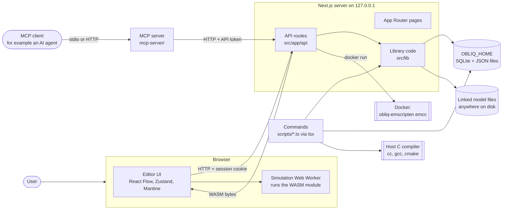
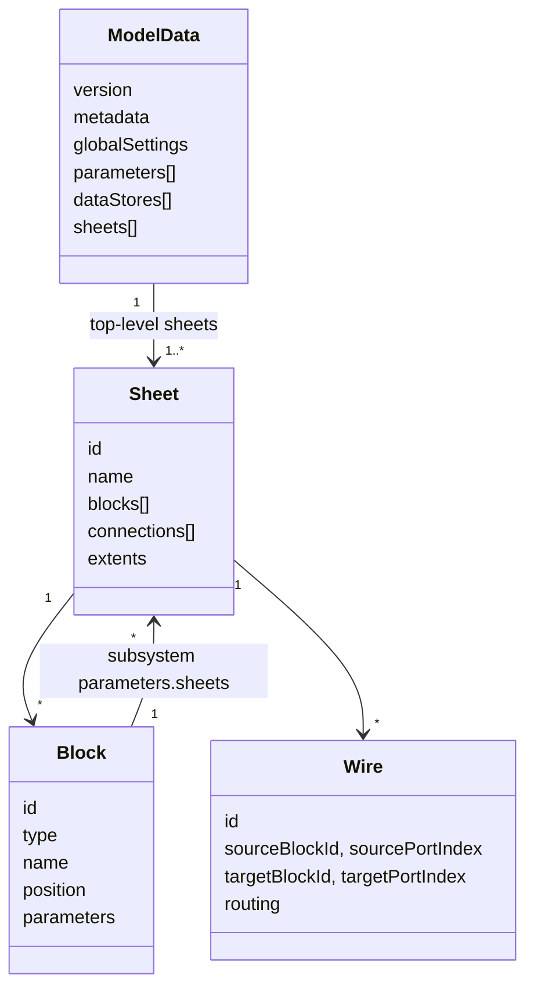
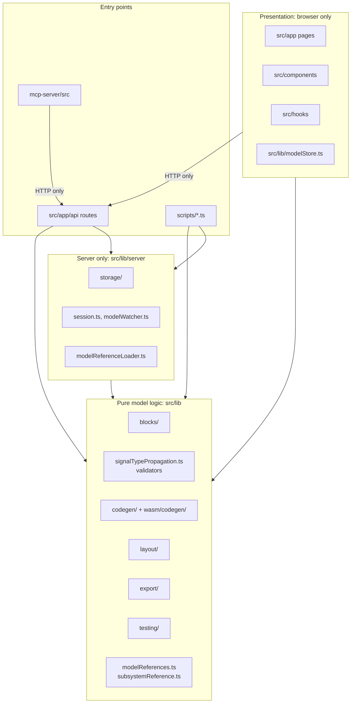
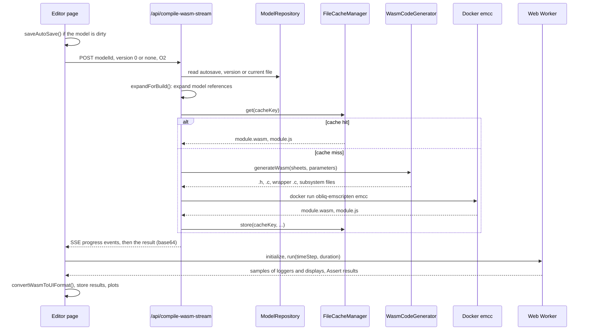
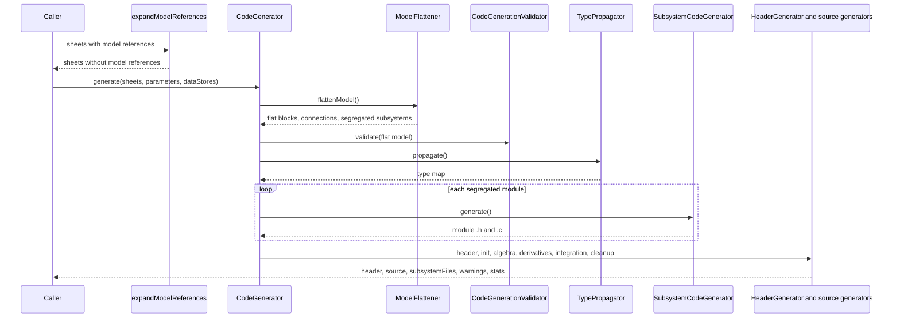

# obliq-2 architecture

This document tells an engineer or a coding agent how obliq-2 is built, so that they can change it safely. It describes the parts and the flow of data and control between them. It also tells where each concern is in the tree, and which rules a change must keep.

It is not a user guide and not a block catalogue. For those, read:

- [README.md](../README.md): features, installation, commands and use.
- [docs/blocks-reference.md](../docs/blocks-reference.md): each block type and its parameters.

All statements here are true of the code on the date of the last edit. Section 17 tells you which sections to update when the code changes.

## Contents

1. [Purpose and scope](#1-purpose-and-scope)
2. [System context](#2-system-context)
3. [Central design decisions](#3-central-design-decisions)
4. [The model document](#4-the-model-document)
5. [Layers and directories](#5-layers-and-directories)
6. [Main flows](#6-main-flows)
7. [Code generation pipeline](#7-code-generation-pipeline)
8. [HTTP API and authentication](#8-http-api-and-authentication)
9. [Storage on disk](#9-storage-on-disk)
10. [Command-line tools](#10-command-line-tools)
11. [Extension points](#11-extension-points)
12. [Invariants and rules](#12-invariants-and-rules)
13. [Testing strategy](#13-testing-strategy)
14. [Known limits and technical debt](#14-known-limits-and-technical-debt)
15. [Glossary](#15-glossary)
16. [Related documents](#16-related-documents)
17. [How to keep this document correct](#17-how-to-keep-this-document-correct)

## 1. Purpose and scope

obliq-2 is a block-diagram modelling tool in the style of Simulink. A user draws a model of blocks and wires on sheets and simulates it. The user checks the model with Assert blocks, and exports it as a C library or a PDF.

obliq-2 is local and single-user by decision. One person runs the server on their own computer, as their own OS user, on `127.0.0.1`. There is no account, no hosted database and no shared model store.

The scope of this document is the obliq-2 repository. It also tells you where obliq-2 touches three external parts:

- The sibling package `mdl2obliq` (Simulink `.mdl` import), which is a file dependency.
- The Emscripten Docker image `obliq-emscripten:latest`, which compiles C to WebAssembly.
- Hosts that embed generated C, for example the obliq-fpv-unity simulator. Their code is not in this repository.

## 2. System context

The parts:

| Part | What it does | Where |
|---|---|---|
| Editor UI | Draws and edits a model, runs simulations, shows plots and test results | `src/app/models/[id]/page.tsx`, `src/components/`, `src/lib/modelStore.ts` |
| API routes | Load and save models, compile to WASM, generate C, Model Builder API, automation API, tokens | `src/app/api/` |
| Library code | All model logic: block modules, type propagation, code generation, layout, PDF, storage | `src/lib/` |
| Local store | Model files, versions, autosaves, SQLite index, WASM cache | `$OBLIQ_HOME`, see section 9 |
| Emscripten image | Compiles generated C to a `.wasm` module and its `.js` loader | Built by `npm run wasm:build-docker` from `__tests__/wasm/docker/Dockerfile.emscripten` |
| MCP server | Gives MCP tools that call the Model Builder and automation APIs | `mcp-server/` (a separate npm package) |
| Commands | Code generation, test runs, layout, PDF and file links without the browser | `scripts/`, see section 10 |

## 3. Central design decisions

Each decision below has a reason. Do not reverse a decision without a new reason that is stronger.

### 3.1 Local and single-user

The server binds to `127.0.0.1` (`npm run dev` and `npm start` pass `-H 127.0.0.1`). `src/middleware.ts` refuses a request whose `Host` is not a loopback name, which stops DNS-rebinding attacks. `OBLIQ_ALLOWED_HOSTS` can add other host names.

Reason: models are engineering files of one person. A local design needs no account system and no network service, and the files stay under the user's control.

### 3.2 The JSON model is the one source of truth

A model is one JSON document (section 4). The canvas, the code generator, the layout engine, the PDF renderer and the commands all read the same document. Nothing else holds model state that persists. The SQLite database is an index: it records where files are and which versions exist, not the model content.

Reason: one representation means that a diagram, its C code and its PDF cannot disagree. A JSON file is also easy to inspect, compare and keep in git.

### 3.3 One generated-C path for simulation, test and export

Simulation runs only generated C. The code generator in `src/lib/codegen/` makes C from the model. The same C is used in three ways:

- Simulation in the editor: compiled to WebAssembly by Emscripten and run in the browser.
- Test runs (`npm run obliq:test`): compiled natively with `OBLIQ_ASSERTS` and run on the host.
- Export: a C project for a host program or an embedded target (editor download and `npm run obliq:cgen`).

Reason: the behaviour that a user simulates and tests is the behaviour that they ship. A second engine would be a second implementation that can disagree.

### 3.4 Block modules are the unit of extension

Each block type that takes part in simulation has a block module in `src/lib/blocks/` that implements `IBlockModule` (`src/lib/blocks/BlockModule.ts`). The `comment` type is an annotation and has no module. A module gives the port counts, the output type for given input types, the C struct members and the C computation. Optional methods give state, derivatives and data collection. `BlockModuleFactory.getBlockModule()` returns the module for a type.

Reason: the knowledge about one block is in one file, and the code generator stays generic.

### 3.5 One block geometry for canvas, layout and PDF

`src/lib/layout/blockGeometry.ts` holds the block sizes and port positions. The canvas (`src/components/BlockNode.tsx`, `src/components/CustomEdge.tsx`), the layout engines, the layout score and the PDF renderer all import it.

Reason: the layout engine calculates wire end points from this geometry. If the drawn geometry and the calculated geometry are different, wires attach at the wrong place.

### 3.6 Pure library code, reused by UI, routes and commands

Most of `src/lib/` has no React and no browser API. The editor, the API routes and the commands in `scripts/` call the same functions. Examples:

- `buildCProject()` in `src/lib/codegen/cProject.ts`: the editor download and `obliq:cgen`.
- `tuneModelLayout()` in `src/lib/layout/tuneModelLayout.ts`: the editor dialog and `obliq:layout`.
- `planModelPdf()` and `renderModelPdf()` in `src/lib/export/modelPdf.ts`: the editor export and `obliq:pdf`.

Reason: a command gives the same result as the editor, and Jest can test the logic without a browser.

Server-only code is in `src/lib/server/`. Do not import it from a client component: it uses the file system and a native SQLite binding.

## 4. The model document

### 4.1 File shapes

A model file has one of two shapes. `parseModelDocument()` in `src/lib/server/storage/ModelRepository.ts` accepts both:

- Wrapper: `{ "name": ..., "data": ModelData }`. Managed models, versions and exports use this shape.
- Bare: a `ModelData` object with a `sheets` array. A linked file can have this shape, and a save keeps it.

### 4.2 Structure

The TypeScript types come from the Zod schema in `src/lib/modelSchema.ts` (`ModelData`, `Sheet`, `Block`, `Wire`, `ModelParameter`, `GlobalSettings`).

Main fields:

- `globalSettings`: `simulationTimeStep`, `simulationDuration`, `integrationAlgorithm` (`rk4` or `euler`) and `debugMath`. Simulation, tests and export all use these values.
- `parameters`: model parameters. Each has a `name` that is a C identifier, a `dataType` and a C99 initializer in `defaultValue`. Blocks can refer to them by name.
- `dataStores`: model-scoped data stores for the Data Store Read and Write blocks.
- `Wire.routing`: an optional `midpointOffset` or absolute `waypoints`. It changes only the drawing.

### 4.3 Hierarchy

The hierarchy has four kinds of block that hold or point to other sheets:

| Kind | How it is stored | Resolved by |
|---|---|---|
| Subsystem | `type: 'subsystem'`, nested `parameters.sheets`, `inputPorts`, `outputPorts` | `ModelFlattener` |
| For Iterator Subsystem | `type: 'for_iterator_subsystem'`, the same parameters plus `iterationLimit`, `resetStates` | `ModelFlattener` |
| Subsystem reference | A subsystem with `isReference: true` and `referencedSubsystemId`, with no sheets of its own | `src/lib/subsystemReference.ts` |
| Model reference | A subsystem with `parameters.modelRef = { modelId, version, name }` | `expandModelReferences()` in `src/lib/modelReferences.ts` |

A model reference with `version: null` follows the latest save of the other model. A number pins it to that saved version. The ports of a model reference are the top-level Input and Output Ports of the referenced model (`modelInterface()`).

### 4.4 Diagram-only fields

Some parameters change only the drawing, not simulation or C: `flipped`, `width`, `height`, `subsystemFunction`, `showName` and the wire `routing`. Layout tools change these fields freely. A layout tool that changes structure (Tidy signal labels) must keep the behaviour, see section 6.6.

### 4.5 Validation in practice

The Zod schema (`validateModelData()` and related functions) is used by tests. The server does not validate a model with it when it loads or saves a file. `parseModelDocument()` checks only the file shape. The checks that the user sees come from these modules:

- `src/lib/blockParameterValidator.ts`: block parameters.
- `src/lib/connectionValidation.ts`: port use and algebraic loops.
- `src/lib/typeCompatibilityValidator.ts` and `src/lib/multiSheetTypeValidator.ts`: signal types across sheets.
- `src/lib/codegen/CodeGenerationValidator.ts`: the flattened model, before C is written.

## 5. Layers and directories

### 5.1 Layers

Rules for the arrows:

- The browser reaches the server only through HTTP. `src/lib/modelApi.ts` is the browser client for `/api/models`.
- The block modules, codegen, layout, export and type propagation run in the browser, in routes and in commands. Do not give them a value import from L1 or L4.
- Many L3 modules import the `BlockData`, `PortInfo` and `WireData` interfaces from `src/components/BlockNode.tsx` and `src/components/Wire.tsx`, and the `Sheet` type from `src/lib/modelStore.ts`. These are type imports only, and TypeScript removes them.
- Some server-only modules are outside `src/lib/server/`: `src/lib/wasm/cache/`, `src/lib/wasm/ServerWasmExecutor.ts`, `src/lib/apiAuthMiddleware.ts`, `src/lib/api-support/` and `src/lib/testing/resolveTestTargets.ts`. Use them only in routes and commands.
- The MCP server does not import obliq-2 code. It calls the HTTP API.

### 5.2 Directory map

| Directory or file | Concern |
|---|---|
| `src/app/page.tsx`, `src/app/models/page.tsx` | Start page and My Models list (import, link, duplicate, delete) |
| `src/app/models/[id]/page.tsx` | The editor page. It starts simulation, code download, layout and PDF export |
| `src/app/tokens/page.tsx`, `src/app/admin/api-metrics/page.tsx` | API token management and Model Builder API metrics |
| `src/app/api/` | HTTP routes, see section 8 |
| `src/middleware.ts` | Loopback `Host` check |
| `src/components/` | React components: `src/components/CanvasReactFlow.tsx`, `src/components/BlockNode.tsx`, `src/components/CustomEdge.tsx`, `src/components/BlockLibrarySidebar.tsx`, the `*Config.tsx` dialogs, plots |
| `src/hooks/` | `src/hooks/useModelFileStatus.ts` (external file changes), `src/hooks/useReferencedModelUpdates.ts`, `src/hooks/useWireValidation.ts` |
| `src/lib/modelStore.ts` | Zustand store: the open model, sheets, selection, clipboard, results, dirty state |
| `src/lib/modelSchema.ts` | Zod schema and model types |
| `src/lib/blocks/` | Block modules and `src/lib/blocks/BlockModuleFactory.ts` |
| `src/lib/blockTypeRegistry.ts`, `src/lib/blockFactory.ts` | Block type metadata, default parameters, block creation |
| `src/lib/signalTypePropagation.ts` | Signal type propagation for the editor, one sheet or many |
| `src/lib/typeValidator.ts` | Parse and compare type strings such as `double[3]` and `double[3][3]` |
| `src/lib/c99*.ts` | C99 expression tokenizer, parser, evaluator, validator and code output |
| `src/lib/codegen/` | C code generation, see section 7 |
| `src/lib/wasm/` | WASM wrapper generator, export list, error parser, disk cache, server-side WASM runner |
| `src/lib/simulation/` | Browser simulation engine, Web Worker, result conversion, Assert results, CSV export |
| `src/lib/plots/signalPlot.ts` | Plot ranges, ticks and labels, shared by screen and PDF |
| `src/lib/layout/` | Block geometry, layout engines, wire routing, layout score |
| `src/lib/export/` | PDF export |
| `src/lib/testing/` | Native Assert test runner and target resolution |
| `src/lib/modelReferences.ts`, `src/lib/referencedModels.ts` | Model reference expansion (pure) and the editor's cache of referenced models |
| `src/lib/subsystemReference.ts` | Subsystem references: resolve, synchronize ports and parameters |
| `src/lib/api-support/` | Model Builder API helpers: rate limit, responses, model load and save |
| `src/lib/server/storage/` | SQLite database, paths, `ModelRepository`, `TokenRepository`, reference-model seeding |
| `src/lib/server/` | Session cookie, file watcher, model reference loader, generator version |
| `src/lib/mdl2obliq/` | Re-exports of the sibling package `mdl2obliq` |
| `src/lib/atmosphere/ussa1976.ts` | 1976 standard atmosphere, used by the Atmosphere block |
| `scripts/` | Commands, see section 10 |
| `scripts/lib/` | Command helpers: `scripts/lib/pdfExport.ts`, `scripts/lib/fpv-tuning.ts`, `scripts/lib/wmm.ts` |
| `mcp-server/` | MCP server package |
| `reference-models/` | Shipped models and their PDFs, generated by the FPV builder |
| `test-models/fpv/` | FPV validation models, generated by the same builder, not seeded |
| `__tests__/` | Jest suites, see section 13 |
| `docs/`, `design/` | Documents. Many files in `docs/` are older plans. Check them against the code |

## 6. Main flows

### 6.1 Open, edit and save a model

1. `AuthProvider` (`src/lib/auth.tsx`) calls `GET /api/session`. The route sets the `obliq_session` cookie.
2. The editor page loads the model with `modelApi.getCurrent()`, which calls `GET /api/models/:id`. `ModelRepository.readCurrent()` reads the model file and returns its data and its hash.
3. `initializeFromModel()` in `src/lib/modelStore.ts` puts the sheets into the store. React Flow (`src/components/CanvasReactFlow.tsx`) draws the active sheet.
4. Each edit is a store action (`addBlock`, `updateBlock`, `addWire` and others). The store sets `isDirty`.
5. `useAutoSave()` (`src/lib/useAutoSave.ts`) runs every 5 minutes. When the model is dirty, it calls `saveAutoSave()`, which sends `PUT /api/models/:id/autosave`. The server writes `autosave.json`.
6. An explicit Save calls `saveModel()`, which sends `POST /api/models/:id/versions` with the data and `baseHash`. `ModelRepository.saveSnapshot()` writes the model file, records a new version and deletes the autosave.
7. If the file on disk changed after the editor read it, the server records the disk content as a version first. Then it compares `baseHash` and returns `409 MODEL_CONFLICT` if they differ.
8. `useModelFileStatus()` listens to `GET /api/models/:id/events` (Server-Sent Events). `src/lib/server/modelWatcher.ts` watches the directory of the file and reports external changes and missing files. `src/components/ExternalChangeBanner.tsx` shows them.

The Model Builder API and MCP write with `ModelRepository.writeInPlace()`. This updates the model file without a new version, unless the caller sends `checkpoint: true`.

### 6.2 Signal type propagation and validation

1. `src/components/CanvasReactFlow.tsx` calls `propagateSignalTypesMultiSheet()` (`src/lib/signalTypePropagation.ts`) on the sheets. It gives a type, such as `double` or `double[3]`, to each wire.
2. Types cross sheets through Sheet Label pairs, and they go into and out of subsystems through their port blocks.
3. The canvas uses the types to draw vector and matrix wires. The PDF export calls the same function.
4. `useWireValidation()` calls `validateModelTypeCompatibilityMultiSheet()`. `src/components/ModelValidationButton.tsx` and `src/components/ModelValidationModal.tsx` show the errors and warnings.
5. Before a simulation, `handleRunSimulation()` in the editor page calls `validateMultiSheetTypeCompatibility()` (`src/lib/multiSheetTypeValidator.ts`).

The code generator does not use this propagation. It has its own `TypePropagator` (`src/lib/codegen/TypePropagator.ts`), which runs on the flattened model and asks each block module for its output type. Section 14 lists this duplication.

### 6.3 Simulate in the editor

The steps, with the files:

1. `src/app/models/[id]/page.tsx` saves the autosave if the model is dirty, then posts to `/api/compile-wasm-stream`. Version `0` means the autosave.
2. The route (`src/app/api/compile-wasm-stream/route.ts`) loads the model and calls `expandForBuild()` (`src/lib/server/modelReferenceLoader.ts`).
3. `generateCacheKey()` (`src/lib/wasm/cache/cacheKey.ts`) makes a key from `CODEGEN_VERSION`, the model id, a hash of the blocks, wires and parameters, and the compile options.
4. On a cache miss, `WasmCodeGenerator` (`src/lib/wasm/codegen/WasmCodeGenerator.ts`) calls the normal `CodeGenerator` and adds a wrapper with `EMSCRIPTEN_KEEPALIVE` functions. The route writes the files to a temporary folder and runs `emcc` in the `obliq-emscripten:latest` container. The exported functions come from `src/lib/wasm/wasmExports.ts`.
5. `FileCacheManager` (`src/lib/wasm/cache/FileCacheManager.ts`) stores the module under the cache folder and records it in the `wasm_cache` table.
6. The page gives the module to `SimulationWorkerManager`, which starts `src/lib/simulation/SimulationWorker.ts`. If a worker is not available, the page uses `WasmSimulationEngine` on the main thread.
7. The C code collects samples for Signal Logger and Signal Display blocks in memory that it allocates. `convertWasmToUIFormat()` (`src/lib/simulation/WasmResultConverter.ts`) maps the samples to blocks and sheets.
8. `readWasmAssertResults()` (`src/lib/simulation/assertResults.ts`) reads the Assert results. An Assert can stop the run early.

The automation API and MCP simulate on the server. `executeServerSimulation()` (`src/lib/wasm/ServerWasmExecutor.ts`) posts to `/api/compile-wasm` with the caller's credentials, then runs the module in a Node `vm` context.

### 6.4 Generate a C project

1. In the editor, **Export → Generate Code** posts to `/api/generate-code`. On the command line, `npm run obliq:cgen` reads a model file.
2. Both expand model references. The route uses the store. The command uses the model files beside the model file, then the store (`expandModelFile()` in `src/lib/testing/resolveTestTargets.ts`).
3. Both call `CodeGenerator.generate()` (the route through `ModelCodeGenerator` in `src/lib/codeGenerationNew.ts`).
4. Both call `buildCProject()` (`src/lib/codegen/cProject.ts`). It returns the files: the model `.c` and `.h`, one pair for each segregated module, `CMakeLists.txt`, `smoke_main.c`, `cgen-manifest.json`, `library.properties` and `README.md`.
5. The route zips the files with JSZip. The command writes them to `--out` and, with `--compile`, builds and runs the smoke test.

`portsFromHeader()` reads the input and output ports from the generated header, so the manifest lists the ports that a host compiles against. `generatorInfo()` (`src/lib/server/generatorInfo.ts`) records the obliq-2 version and git commit in the manifest.

### 6.5 Run Asserts natively

1. `npm run obliq:test -- <model ...>` runs `scripts/obliq-test.ts`.
2. `resolveTestTargets()` finds each model by file path, store id or store name. `--all` adds each stored model that has an Assert block.
3. `runModelTests()` (`src/lib/testing/modelTestRunner.ts`) generates C with `asserts: true` (which defines `OBLIQ_ASSERTS`) and compiles it with `$CC`, else `cc`.
4. The runner steps the model with its saved settings. The step loop is the same as the browser runner: init, seed from inputs, then `simulationStepCount()` steps.
5. The runner reads the results table and prints text, JSON or JUnit XML. The exit codes are:
   - 0: all Asserts passed.
   - 1: an Assert failed or was not checked, or a named model has no Asserts.
   - 2: a model could not be found, built or run.

### 6.6 Automatic layout

1. The editor's **Tune Model Layout** dialog (`src/components/TuneLayoutDialog.tsx`) gives the options. The editor page and `npm run obliq:layout` both call `tuneModelLayout()` (`src/lib/layout/tuneModelLayout.ts`).
2. The scope is `sheet` (default), `subsystem` or `model`. The function is a pure transform of the sheet tree. It does not change the store.
3. The engine is `elk` (default) or `classic`. `src/lib/layout/elkLayout.ts` converts a sheet to an ELK Layered graph, runs `elkjs` and converts the result back. `src/lib/layout/autoLayout.ts` is the classic layered engine.
4. `src/lib/layout/satellites.ts` removes satellite blocks from the ELK graph and puts each one beside its host block.
5. `src/lib/layout/subsystemRole.ts` uses `subsystemFunction` (or a guess from names) to put a loop in the order controller, actuator, plant. `src/lib/layout/returnRow.ts` puts the feedback path on a mirrored row below.
6. `src/lib/layout/wireRouting.ts` places the vertical segment of each wire. Wires of one net share a track.
7. Optional adjustments resize subsystems, show or hide port labels and names, and tidy signal labels (`src/lib/layout/tidyLabels.ts`).
8. `src/lib/layout/layoutMetrics.ts` scores the result. `HARD_METRICS` lists the defects that must be 0.

Tidy signal labels is the only adjustment that changes structure. It replaces a wire with a Sheet Label pair, or the opposite. The behaviour does not change, because `ModelFlattener.resolveSheetLabels()` resolves a label pair to the same connection as a wire.

### 6.7 PDF export

1. The editor's **Export as PDF** dialog (`src/components/ExportPdfDialog.tsx`) gives the options. The editor page and `npm run obliq:pdf` (through `scripts/lib/pdfExport.ts`) both call `planModelPdf()` and `renderModelPdf()` (`src/lib/export/modelPdf.ts`).
2. `src/lib/export/sheetTree.ts` walks the sheet tree and makes the page list with the breadcrumb path of each page.
3. `src/lib/export/modelPdf.ts` runs `propagateSignalTypesMultiSheet()` so that vector and matrix wires print correctly.
4. `src/lib/export/pdfRenderer.ts` draws each sheet as vector graphics with `pdf-lib`, from the model data and `src/lib/layout/blockGeometry.ts`. It does not capture the canvas.
5. `src/lib/export/blockGlyphs.ts` decides how to draw each block symbol. In the browser, `src/lib/export/browserGlyphs.ts` rasterizes symbols that the standard PDF fonts cannot show. The command has no rasterizer, so those symbols use a fallback.
6. The editor can add Signal Display plots (`src/lib/export/pdfPlot.ts`). The command prints diagrams only, because it does not simulate.

### 6.8 A Model Builder API or MCP call

1. An MCP client calls a tool, for example `add_block`. The MCP server (`mcp-server/src/index.ts`, stdio by default, HTTP with `--http`) sends a request to `/api/model-builder` with `Authorization: Bearer <token>`.
2. `src/app/api/model-builder/route.ts` checks the rate limit and authenticates the request. It finds the handler for the `action` in `src/app/api/model-builder/handlers/`.
3. The handler loads the model (`loadModel()` in `src/lib/api-support/auth.ts`), changes it, and saves it with `writeInPlace()`. A `baseHash` gives conflict detection. A `checkpoint` records a version.
4. A batch request runs many operations. In transactional mode, the route writes the content from before the batch back if an operation fails.
5. Simulation and code generation tools call `/api/automations`.

An open editor sees the change through the file watcher (flow 6.1, step 8).

## 7. Code generation pipeline

`CodeGenerator.generate()` (`src/lib/codegen/CodeGenerator.ts`) refuses a model that still has model references. The caller must expand them first.

The stages:

1. `ModelFlattener` (`src/lib/codegen/ModelFlattener.ts`) removes the hierarchy. It gives each block a scoped name, resolves Sheet Label pairs in their scope and decides the strategy of each subsystem.
2. `CodeGenerationValidator` checks the flat model.
3. `TypePropagator` makes the type map. It asks each block module with `getOutputType()`.
4. `SubsystemCodeGenerator` writes one `.h` and `.c` pair for each segregated module.
5. `HeaderGenerator` writes the header: the input, output, signal and state structs and the public functions.
6. The source generators write the functions in this order: `InitFunctionGenerator`, `EnableEvaluator`, `AlgebraicEvaluator`, `RK4Generator` (derivatives), `IntegrationOrchestrator` and `StateIntegrator` (the step), `CleanupFunctionGenerator`.
7. `CCodeBuilder` gives shared helpers, for example `sanitizeIdentifier()`.

### 7.1 Subsystem strategies

The `codeGenStrategy` parameter of a subsystem selects one of three strategies:

| Strategy | Result |
|---|---|
| `flatten` (default) | The blocks of the subsystem go into the parent model's code |
| `segregated` | The subsystem becomes its own C module (`.h` and `.c`). The parent holds an instance of it |
| `segregated_atomic` | A segregated module. The flattener always uses this strategy for subsystem references and for the definitions that they use |

A shared module is one C module for a definition and all its subsystem references. The generator writes it once, and each instance gets its own parameter values at init. [docs/NATIVE_SUBSYSTEM_DESIGN.md](../docs/NATIVE_SUBSYSTEM_DESIGN.md) gives more detail about segregated subsystems. Check its statements against `src/lib/codegen/ModelFlattener.ts` and `src/lib/codegen/SubsystemCodeGenerator.ts`.

### 7.2 Integration

The generated code separates algebra (outputs from inputs and states) from integration (states from derivatives). `globalSettings.integrationAlgorithm` selects `rk4` or `euler`. In `rk4`, the algebra runs again at each stage, and the major-step values are restored after the stages. `debugMath` adds safe divide and modulo and finite-value checks on each RK4 stage (`src/lib/codegen/DebugMathRuntime.ts`).

### 7.3 Profiles

A profile changes the files of a command-line C project. `buildCProject()` accepts an optional `profile` with a name, a replacement `smoke_main.c`, extra files and extra sources. `npm run obliq:cgen -- --profile <name>` selects it. `generic` is the default and adds nothing. The editor download always uses `generic`.

## 8. HTTP API and authentication

### 8.1 Authentication

`authenticateRequest()` in `src/lib/apiAuthMiddleware.ts` accepts two credentials, in this order:

1. `Authorization: Bearer <token>`: an API token from the `/tokens` page. The token is 128 hex characters. The database keeps only its SHA-256 hash (`api_tokens` table). MCP, automation clients and scripts use tokens.
2. The `obliq_session` cookie: `GET /api/session` sets it for same-origin requests. Its value is an HMAC of a constant, with the key in `$OBLIQ_HOME/local-secret` (`src/lib/server/session.ts`). The browser uses the cookie.

All requests also pass the loopback `Host` check in `src/middleware.ts`.

### 8.2 Routes

| Route | Methods | Purpose | Authentication |
|---|---|---|---|
| `/api/session` | GET | Set the session cookie, return the local user | Same-origin check only |
| `/api/models` | GET, POST | List models, create a managed model | Token or cookie |
| `/api/models/link` | POST | Link an external model file | Token or cookie |
| `/api/models/[id]` | GET, PATCH, DELETE | Read the current file, rename, delete | Token or cookie |
| `/api/models/[id]/versions` | GET, POST | List versions, explicit save | Token or cookie |
| `/api/models/[id]/versions/[version]` | GET | Read one version | Token or cookie |
| `/api/models/[id]/autosave` | GET, PUT, DELETE | Autosave | Token or cookie |
| `/api/models/[id]/duplicate` | POST | Copy a model | Token or cookie |
| `/api/models/[id]/unlink` | POST | Copy a linked file into managed storage | Token or cookie |
| `/api/models/[id]/status` | GET | File status (ok, changed, missing) | Token or cookie |
| `/api/models/[id]/events` | GET | Server-Sent Events of file status | Token or cookie |
| `/api/models/[id]/dependents` | GET | Models that reference this model | Token or cookie |
| `/api/compile-wasm` | POST | Compile to WASM, JSON response | Token or cookie |
| `/api/compile-wasm-stream` | POST | Compile to WASM, SSE progress and result | Token or cookie |
| `/api/generate-code` | POST | C project as a zip | Token or cookie |
| `/api/model-builder` | GET, POST, PUT, DELETE | Model Builder API, by `action` | Token or cookie, rate limit |
| `/api/automations` | POST | `generateCode`, `simulate`, `validateModel`, `listModels` | Token or cookie |
| `/api/tokens` | GET, POST | List and create API tokens | Token or cookie |
| `/api/tokens/[id]` | GET, DELETE | Read and delete a token | Token or cookie |
| `/api/cache-maintenance` | POST | Evict WASM cache entries | Token or cookie, or `x-api-key` equal to `CACHE_MAINTENANCE_API_KEY` |

The `/api/models` routes use `modelsRoute()` (`src/lib/server/modelsApi.ts`). It authenticates the request and maps storage errors to HTTP codes (for example 404, 409).

API references:

- [docs/model-builder-api.md](../docs/model-builder-api.md): Model Builder actions.
- [docs/automation-api.md](../docs/automation-api.md): automation actions.
- [docs/wasm-compilation-api.md](../docs/wasm-compilation-api.md): compile routes.
- [mcp-server/README.md](../mcp-server/README.md): MCP tools and configuration.

## 9. Storage on disk

### 9.1 Layout

`resolveObliqHome()` (`src/lib/server/storage/paths.ts`) selects the store folder: `$OBLIQ_HOME`, else `${XDG_CONFIG_HOME:-~/.config}/obliq-2`.

| Path under the store folder | Content |
|---|---|
| `obliq.db` | SQLite database (WAL mode) |
| `local-secret` | Key for the session cookie, mode 0600 |
| `models/<id>/model.json` | The current file of a managed model |
| `models/<id>/autosave.json` | The autosave, managed or linked |
| `models/<id>/versions/vNNNN.json` | Saved versions, managed or linked, wrapper shape |
| `cache/wasm/<cacheKey>/` | `module.wasm` and `module.js` |

A linked model keeps its current file where the user put it. Its versions and autosave are in the store folder. Deleting a linked model does not delete the external file. Model ids and cache keys must match `^[A-Za-z0-9._-]+$`, so that they cannot leave their folder.

### 9.2 SQLite tables

`src/lib/server/storage/db.ts` applies forward-only migrations and records the schema version in `PRAGMA user_version`. A build refuses a database that is newer than its migrations.

| Table | Content |
|---|---|
| `models` | One row per model: name, `storage_kind` (`managed` or `linked`), `file_path`, `file_format` (`wrapper` or `bare`), `file_hash`, `latest_version`, times |
| `model_versions` | One row per saved version: hash, size, note, time |
| `api_tokens` | Token name, SHA-256 hash, expiry, last use |
| `wasm_cache` | One row per cached module: key, model hash, options, sizes, access count |
| `wasm_compilation_metrics` | One row per compile request: cache hit, time, error |
| `wasm_simulation_metrics` | Simulation metrics |
| `meta` | Key and value pairs, for example `reference_models` |

`getStorage()` (`src/lib/server/storage/index.ts`) opens one connection for each process. It keeps the connection on `globalThis`, so that a Next.js dev reload uses it again.

### 9.3 Reference-model seeding

When `openStorage()` creates a new store, it imports each `*.json` file in `reference-models/` one time (`src/lib/server/storage/referenceModels.ts`). The `reference_models` meta key records the result. Seeding never changes an existing store. `OBLIQ_REFERENCE_MODELS_DIR` selects a different folder, and an empty value turns seeding off. `jest.setup.js` turns it off for tests.

## 10. Command-line tools

The commands run with `tsx` and import `src/lib/` directly. None of them needs the server to run.

| Command | Script | Purpose |
|---|---|---|
| `npm run obliq:cgen` | `scripts/obliq-cgen.ts` | Write a C project from a model file |
| `npm run obliq:test` | `scripts/obliq-test.ts` | Run the Asserts of models natively |
| `npm run obliq:layout` | `scripts/obliq-layout.ts` | Apply the editor's layout to a model file, or score its layout |
| `npm run obliq:pdf` | `scripts/obliq-pdf.ts` | Write a PDF of a model file |
| `npm run obliq:link` | `scripts/obliq-link.ts` | Link, list or unlink model files in the store |
| `npm run mdl:ir`, `npm run mdl:emit` | `../mdl2obliq` | Simulink `.mdl` to IR, and IR to an obliq-2 model |
| `npm run wasm:build-docker` | `__tests__/wasm/docker/Dockerfile.emscripten` | Build the Emscripten image |
| `npm run mcp-server:dev`, `npm run mcp-server:build` | `mcp-server/` | Run or build the MCP server |

Other scripts:

- `scripts/build-fpv-reference-model.ts` builds the FPV models in `reference-models/` and `test-models/fpv/`, lays them out and writes their PDFs. Run it with `npx tsx --tsconfig tsconfig.json scripts/build-fpv-reference-model.ts`.
- `scripts/fpv-tuning-sweep.ts` prints the response of the FPV rate loop across mass, motor lag and IMU rate variants. `__tests__/reference-models/fpv-tuning.test.ts` holds the limits.

`obliq:link` always opens the SQLite store. `obliq:test`, `obliq:cgen` and `obliq:pdf` open it when a model reference is not found beside the model file. `obliq:test` also opens it for a model given by store id or name, and for `--all`. The `better-sqlite3` native module must be built for the Node version that runs the command.

## 11. Extension points

### 11.1 Add a block type

A block type is known in many places. Follow [docs/adding-new-block-types.md](../docs/adding-new-block-types.md) and [docs/block-modules.md](../docs/block-modules.md). The minimum is:

1. Write a module in `src/lib/blocks/` that implements `IBlockModule`.
2. Add it to `BlockModuleFactory.createInstance()` and `getSupportedBlockTypes()`.
3. Add it to `BlockTypes` and `blockTypeRegistry` in `src/lib/blockTypeRegistry.ts`, and its defaults in `src/lib/blockFactory.ts`.
4. Add it to the palette in `src/components/BlockLibrarySidebar.tsx` and its symbol in `src/components/BlockNode.tsx`.
5. Add its PDF symbol class in `src/lib/export/blockGlyphs.ts`.
6. Add its type rules to `src/lib/signalTypePropagation.ts`, and its parameter checks to `src/lib/blockParameterValidator.ts`.
7. Add it to the block list of the MCP server, `mcp-server/src/tools/block-types.ts`.
8. Add a configuration dialog in `src/components/` if it has parameters.
9. Add its entry to [docs/blocks-reference.md](../docs/blocks-reference.md).

`__tests__/block-type-consistency.test.ts` compares the factory, the registry, the palette and the MCP list. It fails on a new gap. If the block has states, add a native numeric test (section 13).

### 11.2 Add a code generation profile

1. Add the profile name to the `--profile` choices in `scripts/obliq-cgen.ts`.
2. Give `buildCProject()` a `profile` object with the replacement smoke main, the extra files and their sources.
3. Add a test that builds the project with the profile.

Do not change `generic`. `__tests__/cgen-project-parity.test.ts` checks that the editor download and the command give the same files.

### 11.3 Add a command

1. Put the logic in `src/lib/` as pure functions, so that the editor and Jest can use them.
2. Write a thin `scripts/<name>.ts` that parses arguments, reads files and calls the library.
3. Add an `obliq:<name>` script to `package.json`.
4. Accept the wrapper and bare file shapes, as the other commands do.
5. Resolve model references in the same order as `obliq:test`: files beside the model file, by name, then the store.

### 11.4 Add an API route

1. Put the route in `src/app/api/<name>/route.ts` with `export const runtime = 'nodejs'`.
2. Authenticate with `authenticateRequest()`, or use `modelsRoute()` for model routes.
3. Read and write models only through `getStorage().models`.
4. Call `expandForBuild()` before code generation.
5. Add the route to the table in section 8.2.

### 11.5 Change the generated C or the WASM wrapper

1. Increase `CODEGEN_VERSION` in `src/lib/wasm/cache/cacheKey.ts` and add a line to its history. Otherwise the cache returns old modules.
2. For a new wrapper function, add it to `WASM_EXPORTED_FUNCTIONS` in `src/lib/wasm/wasmExports.ts`. Both compile routes read this list.

## 12. Invariants and rules

A change must keep these rules. A test protects most of them.

1. **One block geometry.** Block sizes and port positions come only from `src/lib/layout/blockGeometry.ts`. Do not copy the formulas into a component or a renderer.
2. **Reference models equal the builder output.** Do not edit `reference-models/*.json`, `reference-models/*.pdf` or `test-models/fpv/*.json` by hand. Change `scripts/build-fpv-reference-model.ts` and run it again. Three tests compare the files:
   - `__tests__/reference-models/fpv-test-models.test.ts`: `test-models/fpv/*.json`, byte for byte.
   - `__tests__/reference-models/fpv-pdfs.test.ts`: `reference-models/*.pdf`, byte for byte.
   - `__tests__/reference-models/fpv-plant.test.ts`: `reference-models/*.json`, as parsed JSON. This test does not find a change of key order or white space. Write the files only with the builder, so that they also stay equal byte for byte.
3. **Public port names of shipped models do not change.** Hosts such as obliq-fpv-unity read the FPV Vehicle ports by name from the generated header. Do not rename the Input or Output Ports of a shipped model without the agreement of the owner.
4. **The layout score's hard metrics stay 0.** `HARD_METRICS` in `src/lib/layout/layoutMetrics.ts` lists them. `__tests__/layout-metrics.test.ts` compares the scores with `__tests__/layout-metrics.golden.json`.
5. **Diagram-only fields do not change behaviour.** `flipped`, `subsystemFunction`, sizes and wire routing must not change the generated C. A layout tool that changes structure must give the same connections after `resolveSheetLabels()`.
6. **One generated-C path.** Simulation, tests and export use `CodeGenerator`. Do not add a second simulation engine or a second generator.
7. **Editor and command give the same output.** Keep the shared library function as the only implementation (`buildCProject()`, `tuneModelLayout()`, `renderModelPdf()`). `__tests__/cgen-project-parity.test.ts` compares the two C projects.
8. **Bump `CODEGEN_VERSION`** when the generated C or the wrapper changes (section 11.5).
9. **Server code stays on the server.** Do not import `src/lib/server/` from a client component.
10. **Saves go through `ModelRepository`.** Do not write model files directly. The repository keeps the hashes, versions and conflict checks correct.
11. **Units in names.** In engineering models that you create or change, put a unit suffix on signal names and on blocks with continuous states. The table of suffixes is in [CLAUDE.md](../CLAUDE.md).
12. **Sensor fidelity.** Check a sensor model against its datasheet, along the whole path, and with independent numbers. Read [CLAUDE.md](../CLAUDE.md) before you change a sensor model.
13. **Documentation style.** Write documents in ASD-STE100 Simplified Technical English as far as practical (see [CLAUDE.md](../CLAUDE.md)). Put release notes in [CHANGELOG.md](../CHANGELOG.md), not in README.md.

## 13. Testing strategy

All automatic tests are Jest suites under `__tests__/` (`jest.config.js`, environment `jsdom`). `npm test` runs all of them. The groups:

| Group | Location | Needs |
|---|---|---|
| Unit tests of blocks, types, store, layout, PDF | `__tests__/*.test.ts`, `__tests__/lib/` | Node only |
| Code generation | `__tests__/codegen/` | Node; the `*-native` suites also need a host C compiler |
| Native numeric tests | `__tests__/support/nativeCgen.ts` and its users | `cmake` and `gcc` |
| Storage and model API | `__tests__/storage/`, `__tests__/model-reference-api.test.ts` | `better-sqlite3` built for the Node that runs Jest |
| Reference models | `__tests__/reference-models/` | `cmake` and `gcc` for the tests that fly the FPV models (`__tests__/support/nativeCgen.ts`) |
| WASM | `__tests__/wasm/` (`npm run test:wasm`) | Docker and the `obliq-emscripten:latest` image |
| Generated C compile | `__tests__/integration/code-generation/` (`npm run test:codegen`) | Docker |
| HTTP API and MCP | `__tests__/integration/api/`, `__tests__/integration/mcp/` (`npm run test:integration`) | A running server and `TEST_API_TOKEN` |

Golden files and byte comparisons:

- `__tests__/layout-metrics.golden.json`: layout scores of the FPV Vehicle, one entry for each engine. Refresh it only after a change that makes the score better: `UPDATE_LAYOUT_GOLDEN=1 npx jest __tests__/layout-metrics.test.ts`.
- `reference-models/` and `test-models/fpv/`: the builder output (see section 12, rule 2).
- `__tests__/cgen-project-parity.test.ts`: the editor and command C projects.

Rules for new tests:

- Test a numeric block or a sensor model against independent numbers, not only against the formula that it implements. Run it through the generated C, natively, with `__tests__/support/nativeCgen.ts` or a model with Asserts.
- A model with Asserts is also a test. `npm run obliq:test` runs it, and the editor shows its results.
- `npx tsc --noEmit` reports errors that existed before this document (132 on 13 Nov 2026). `next build` checks only `src/` (`tsconfig.build.json`). Do not add new errors. Compare the count before and after your change.

## 14. Known limits and technical debt

Each item below is true in the code today. Most are kept on purpose until there is time to change them safely.

- **Doubled instance field names.** `ModelFlattener.analyzeSegregatedSubsystem()` joins `parentPath` and the block name, but `parentPath` already ends with the block name. The FPV Vehicle header therefore has fields such as `Motor_RR_Motor_RR`. The names are kept for now, because hosts compile against them.
- **Two type propagators.** The editor uses `src/lib/signalTypePropagation.ts`. The code generator uses `src/lib/codegen/TypePropagator.ts`. They can disagree.
- **The Zod schema is not applied at run time.** Section 4.5 tells which checks run. The block `type` enum in `src/lib/modelSchema.ts` lists fewer types than `BlockModuleFactory`.
- **Two compile routes.** `/api/compile-wasm` and `/api/compile-wasm-stream` hold similar code, so a change to one must go into the other. The automation API and MCP simulations use `/api/compile-wasm`; the editor uses `/api/compile-wasm-stream`.
- **Unused import function.** `ModelRepository.importModel()` has no caller.
- **ELK runs on the browser main thread.** `src/lib/layout/elkLayout.ts` loads `elkjs/lib/elk.bundled.js`. A large layout blocks the editor until it ends.
- **Server-only code is in more than one place.** Section 5.1 lists the server-only modules outside `src/lib/server/`. Model types are declared in components (`BlockData`, `WireData`) and in `src/lib/modelSchema.ts`.
- **The editor page is large.** `src/app/models/[id]/page.tsx` holds the simulation, code download, layout and PDF actions. `src/lib/modelStore.ts` is also large.
- **Asserts in segregated subsystems are not checked.** The generator gives a warning and leaves them out.
- **Sibling dependency.** `mdl2obliq` is `file:../mdl2obliq` in `package.json`, and `jest.config.js` maps it to `../mdl2obliq/src`. `npm install` and some tests need that folder beside obliq-2.
- **Old compatibility layers.** `src/lib/codeGeneration.ts` is deprecated, and `src/lib/codeGenerationNew.ts` wraps `CodeGenerator`. One test still uses the old function.
- **Rate limit store in memory.** `checkRateLimit()` in `src/lib/api-support/auth.ts` keeps counts in a `Map`. A server restart clears them.
- **The command PDFs have no glyph rasterizer.** Some block symbols use a fallback in `obliq:pdf` output (section 6.7).
- **Pre-existing TypeScript errors** under `tsc --noEmit` (section 13).

## 15. Glossary

| Term | Meaning |
|---|---|
| Block | One element of a diagram, with a `type`, a `name`, a `position` and `parameters` |
| Block module | The class that gives the ports, types and C code of one block type (`src/lib/blocks/`) |
| Wire | A connection from one output port to one input port (`connections` in a sheet) |
| Net | All the wires that start at the same output port. The wire router lets one net share a track |
| Sheet | One diagram page: blocks, wires and extents. A model has top-level sheets, and a subsystem has nested sheets |
| Subsystem | A block that holds its own sheets, with Input Port and Output Port blocks as its ports |
| Subsystem reference | A subsystem that uses the sheets of a definition subsystem in the same model, with its own parameter values |
| Model reference | A subsystem that embeds another saved model. Its ports are the top-level ports of that model |
| Sheet Label Sink, Sheet Label Source | A pair of blocks that carries a named signal without a drawn wire, in one scope: the top-level sheets, or the sheets of one subsystem |
| Segregated subsystem | A subsystem with `codeGenStrategy` `segregated` or `segregated_atomic`. It becomes its own C module |
| Shared module | One C module for a definition subsystem and all its references |
| Satellite | A leaf block with one wire, such as a Sheet Label, a constant or a display. The ELK layout puts it beside its host block |
| Return row | The feedback path of a control loop, drawn mirrored on a row below the forward path |
| Subsystem function | The role of a subsystem in a loop (`controller`, `actuator`, `plant`, `sensor`, `compensator`, `other`). Only the layout uses it |
| Profile | A command-line variant of the C project files (section 7.3) |
| Managed model | A model whose current file is in the store folder |
| Linked model | A model whose current file is outside the store folder |
| Autosave | The unsaved state of a model, written every 5 minutes when it is dirty. Compile requests call it version 0 |

## 16. Related documents

| Document | Use it for |
|---|---|
| [README.md](../README.md) | Features, setup and commands |
| [CHANGELOG.md](../CHANGELOG.md) | Release history |
| [docs/blocks-reference.md](../docs/blocks-reference.md) | Block types and parameters |
| [docs/block-modules.md](../docs/block-modules.md) | The block module interface |
| [docs/adding-new-block-types.md](../docs/adding-new-block-types.md) | The steps to add a block type |
| [docs/code-generation-architecture.md](../docs/code-generation-architecture.md) | Generated C structure and integration methods |
| [docs/NATIVE_SUBSYSTEM_DESIGN.md](../docs/NATIVE_SUBSYSTEM_DESIGN.md) | Segregated subsystems as C modules |
| [docs/model-testing-plan.md](../docs/model-testing-plan.md) | Assert blocks, the test runner and model references |
| [docs/layout-engine-comparison.md](../docs/layout-engine-comparison.md), [docs/layout-improvement-plan-pass-2.md](../docs/layout-improvement-plan-pass-2.md) | The ELK layout and its phases |
| [docs/model-builder-api.md](../docs/model-builder-api.md), [docs/automation-api.md](../docs/automation-api.md) | HTTP APIs |
| [reference-models/README.md](../reference-models/README.md) | Shipped models, their layout and PDFs |
| [mcp-server/README.md](../mcp-server/README.md) | MCP server |
| [__tests__/wasm/README.md](../__tests__/wasm/README.md) | WASM tests and the Docker image |

Some of these documents are older than the code. When a document and the code disagree, the code is correct.

## 17. How to keep this document correct

Update this document in the same change as the code. Use this table to find the sections:

| When you change | Update |
|---|---|
| A route under `src/app/api/`, or authentication | Sections 2, 6 and 8 |
| `src/lib/server/storage/` (paths, tables, migrations) | Section 9 |
| A `package.json` script or a file in `scripts/` | Section 10 |
| The model schema or the hierarchy kinds | Section 4 and the glossary |
| The code generation stages, strategies or profiles | Sections 7 and 11.2 |
| The simulation path, the cache or the WASM exports | Section 6.3 and section 11.5 |
| The layout engines or the layout score | Sections 6.6 and 12 |
| The PDF export | Section 6.7 |
| The places that know a block type | Section 11.1 |
| A test group, a golden file or a tool that tests need | Section 13 |
| An item in section 14 is fixed | Remove it from section 14 |
| A new top-level directory | Section 5.2 |

Before you commit, check that each path in backticks exists and that each `npm run` command is in `package.json`.
